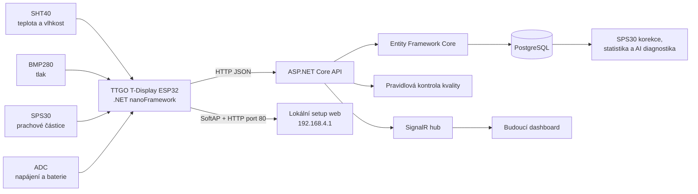
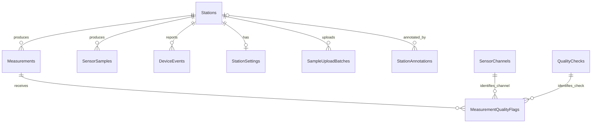
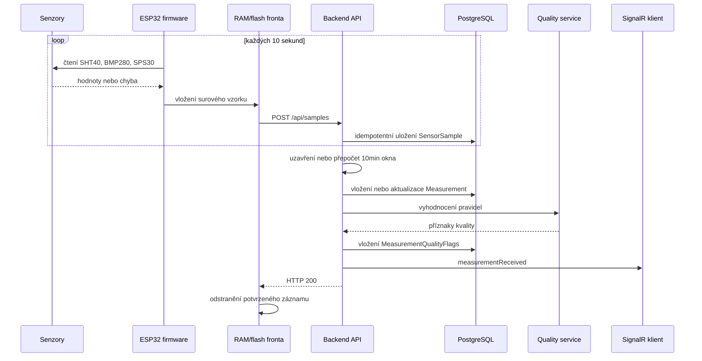

# MeteoStanice - architektura a podrobný popis systému

## 1. Účel dokumentu

Tento dokument popisuje aktuální technický stav systému MeteoStanice. Je určen jako podklad pro technickou část diplomové práce. Popisuje:

- fyzickou meteostanici založenou na ESP32 a .NET nanoFramework,
- připojené senzory a způsob jejich čtení,
- lokální konfiguraci stanice,
- sběr surových vzorků, jejich odolné frontování a backendovou agregaci,
- backendové REST API v ASP.NET Core,
- databázi PostgreSQL a význam všech tabulek a sloupců,
- registraci a rozlišení více fyzických stanic,
- kontrolu kvality dat,
- nasazení pomocí Dockeru na lokálním serveru nebo NAS,
- současná omezení a plán dalšího rozvoje,
- plán kalibrace, statistické diagnostiky a AI klasifikace poruch senzorů.

Dokument rozlišuje mezi funkcemi, které jsou již implementovány, a funkcemi plánovanými pro další fázi projektu.

## 2. Cíl systému

Cílem systému je provozovat více samostatných nízkonákladových meteostanic, které:

1. periodicky čtou fyzikální veličiny z připojených senzorů,
2. odesílají časově zarovnané desetisekundové vzorky,
3. uchovávají diagnostické informace o kvalitě jednotlivých čtení,
4. odesílají výsledky přes Wi-Fi do centrálního API,
5. automaticky se registrují v backendu,
6. ukládají data do PostgreSQL,
7. umožňují zpětné vyhodnocení kvality, kalibraci a budoucí diagnostiku vad senzorů.

Systém je navržen pro více fyzických stanic. Každá stanice má vlastní trvalý identifikátor `StationGuid`, hardwarový identifikátor a backendem přidělený čitelný kód, například `meteostanice-001`.

## 3. Celková architektura



Systém se skládá z následujících vrstev:

| Vrstva | Projekt nebo zařízení | Úloha |
|---|---|---|
| Senzorická vrstva | SHT40, BMP280, SPS30 | Fyzické měření prostředí |
| Vestavěná vrstva | `MeteoStanice` | Firmware ESP32, vzorkování, offline fronta, setup, komunikace |
| Přenosová vrstva | Wi-Fi, HTTP, JSON | Přenos měření a událostí |
| Aplikační vrstva | `MeteoStanice.Api` | Registrace stanic, příjem dat, API, migrace |
| Datová vrstva | `MeteoStanice.Data` | Entity Framework Core model a PostgreSQL |
| Kontraktní vrstva | `MeteoStanice.Contracts` | Datové objekty přenášené mezi zařízeními a API |
| Vrstva kvality | `MeteoStanice.Quality` | Pravidlové vyhodnocení kvality měření |
| Prezentační vrstva | `MeteoStanice.Monitor`, `MeteoStanice.Web` | Funkční WPF monitor a připravená kostra webového dashboardu |

## 4. Struktura řešení

### 4.1 Projekt `MeteoStanice`

Firmware pro LILYGO TTGO T-Display ESP32. Cílovou platformou je `.NET nanoFramework,Version=v1.0`. Projekt obsahuje:

- ovladače I2C senzorů,
- hlavní nekonečnou provozní smyčku,
- časově zarovnané desetisekundové vzorkování,
- RAM staging a kruhovou flash frontu surových vzorků,
- samostatnou kruhovou flash frontu událostí,
- HTTP klienta,
- Wi-Fi klienta s automatickým obnovením spojení,
- sledování poruch a zotavení senzorů (události),
- SoftAP provisioning portal,
- práci s interní flash pamětí,
- obsluhu tlačítka,
- ST7789 displej,
- NTP synchronizaci,
- sledování napájení a baterie.

### 4.2 Projekt `MeteoStanice.Api`

ASP.NET Core Web API pro .NET 10. Obsahuje:

- příjem surových desetisekundových vzorků a událostí,
- backendovou desetiminutovou agregaci a čtení agregátů,
- automatickou registraci fyzických stanic (`StationRegistrationService`),
- autentizaci zařízení pomocí API klíče a oddělený administrátorský klíč,
- automatické databázové migrace při startu,
- kontrolu kvality agregovaných měření,
- SignalR hub pro budoucí živý dashboard,
- Swagger dokumentaci.

### 4.3 Projekt `MeteoStanice.Data`

Datová vrstva používající Entity Framework Core 10 a provider Npgsql pro PostgreSQL. Obsahuje entity, konfiguraci indexů a databázové migrace.

### 4.4 Projekt `MeteoStanice.Contracts`

Definuje přenosové objekty a sdílené katalogy:

- `SensorSampleUploadRequest`, `SensorSampleDto`, `SensorSamplePageDto`, `SensorSampleUploadResultDto`,
- `MeasurementDto`,
- `DeviceEventUploadRequest`, `DeviceEventDto`,
- `StationDto`, `UpdateSps30CorrectionRequest`,
- `QualityFlagDto`,
- `FirmwareProtocol` (verze JSON protokolu),
- `FirmwareStatusCatalog` (číselníky stavů a událostí sdílené s firmwarem a Monitorem).

### 4.5 Projekt `MeteoStanice.Quality`

Obsahuje první vrstvu automatické kontroly dat založenou na explicitních pravidlech a statistikách vypočtených backendovou agregací (`MeasurementQualityService`) a katalog názvů kanálů a kontrol (`QualityCatalog`).

### 4.6 Projekt `MeteoStanice.Monitor`

Funkční WPF monitor čte PostgreSQL v režimu pouze pro čtení (10min agregáty, události, příznaky kvality) a každých 10 s endpoint `GET /api/samples/latest`, ze kterého zobrazuje poslední 10s vzorek každé stanice. Vyhodnocuje dostupnost stanic a senzorové problémy (z 10min agregátů) a spouští zvukové alarmy. Hmotnostní koncentrace SPS30 pro zobrazení upravuje podle `Stations.Sps30CorrectionPercent`; raw databázové hodnoty nemění.

### 4.7 Projekt `MeteoStanice.Web`

Připravená kostra webového dashboardu (Blazor). Obsahuje pouze úvodní stránku s popisem; ukázkové stránky šablony byly odstraněny. Funkční dashboard zatím není implementován. Dřívější prázdný projekt `MeteoStanice.Desktop` byl odstraněn, jeho roli plní `MeteoStanice.Monitor`.

### 4.8 Solution soubory

- `MeteoStanice.Backend.sln` – API, Data, Contracts, Quality, Web a Monitor,
- `MeteoStanice.Monitor.sln` – samostatné otevření Monitoru,
- `MeteoStanice.slnx` – firmware (vyžaduje rozšíření .NET nanoFramework pro Visual Studio).

## 5. Hardwarová část meteostanice

### 5.1 Řídicí deska

Použitá deska je `LILYGO TTGO T-Display ESP32 1.14` s firmware targetem `ESP32_GenericDisplay_REV0`.

Důležité piny:

| Funkce | GPIO |
|---|---:|
| I2C SDA | 21 |
| I2C SCL | 22 |
| SPI SCK displeje | 18 |
| SPI MOSI displeje | 19 |
| SPI MISO | 12 |
| Display CS | 5 |
| Display DC | 16 |
| Display reset | 23 |
| Podsvícení | 4 |
| ADC baterie | 34 |
| Napájení ADC děliče | 14 |
| Setup tlačítko | 35 |

Displej ST7789 má fyzické rozlišení 135 x 240 bodů a firmware jej používá v orientaci odpovídající rozložení TTGO T-Display.

### 5.2 SHT40

SHT40 měří:

- teplotu ve stupních Celsia,
- relativní vlhkost v procentech.

Komunikace probíhá přes I2C na adrese `0x44`. Firmware používá příkaz `0xFD`, čeká 12 ms a načte šest bajtů. Každá dvojice datových bajtů je chráněna CRC.

Převod surových hodnot:

```text
teplota = -45 + 175 * rawTemperature / 65535
vlhkost = -6 + 125 * rawHumidity / 65535
```

Vlhkost je následně omezena do fyzikálního rozsahu 0 až 100 %.

### 5.3 BMP280

BMP280 měří atmosférický tlak. Pomocná teplota čipu se používá pro kompenzační výpočet tlaku, není však ukládána jako hlavní teplota prostředí.

Firmware hledá senzor na adresách:

- `0x76`,
- `0x77`.

Ověřuje identifikátor čipu `0x58`, provede softwarový reset, načte tovární kalibrační konstanty z registrů od `0x88` a používá forced mode. Výsledný tlak se ukládá v hPa.

Tovární kompenzační konstanty BMP280 nejsou uživatelskou kalibrací stanice. Jde o součást standardního převodu surových dat senzoru.

### 5.4 SPS30

SPS30 měří aerosolové částice přes I2C na adrese `0x69`. Firmware při prvním použití spustí měření příkazem `0x0010` s argumentem `0x0300`.

Zpracovávané hodnoty:

- hmotnostní koncentrace PM1.0,
- hmotnostní koncentrace PM2.5,
- hmotnostní koncentrace PM4.0,
- hmotnostní koncentrace PM10,
- početní koncentrace NC0,5 (částice 0,3–0,5 µm),
- početní koncentrace NC1,0 (0,3–1,0 µm),
- početní koncentrace NC2,5 (0,3–2,5 µm),
- početní koncentrace NC4,0 (0,3–4,0 µm),
- početní koncentrace NC10 (0,3–10 µm),
- typická velikost částic.

Všech deset hodnot se přenáší na backend (od protokolu verze 2 včetně početních koncentrací v #/cm³).

Před čtením hodnot se kontroluje příznak připravenosti dat. Data SPS30 jsou chráněna CRC po jednotlivých datových slovech. Pokud data ještě nejsou připravena, stav je veden jako `WAIT` (kód `Timeout`), nikoli jako tvrdá chyba senzoru.

Další ošetření SPS30 ve firmwaru:

- **Náběh po startu:** prvních 30 s po spuštění měření se hodnoty SPS30 nepoužijí a senzor hlásí `WAIT`. Sensirion uvádí dobu ustálení 8 až 30 s podle koncentrace.
- **Startovací brána:** po startu nebo restartu stanice se nevytvářejí, neukládají ani neodesílají žádné vzorky (ani SHT40 a BMP280), dokud SPS30 nedokončí náběh a nevrátí první platné čtení. Data tak začínají až s platnými hodnotami PM. Na displeji je místo stavu fronty `SPS`. Pojistka: pokud SPS30 nenaběhne do 12 cyklů (asi 2 minut, např. chybí nebo je vadný), ukládání začne i bez něj, aby se neztratila teplota, vlhkost a tlak. Brána platí jen po startu; pozdější chyby SPS30 se zaznamenávají ve vzorcích. Události stanice se odesílají i během brány.
- **Stavový registr:** přibližně jednou za minutu firmware čte registr stavu zařízení (příkaz `0xD206`, firmware senzoru 2.2 a novější). Bit poruchy ventilátoru vede na `FanError`, bit poruchy laseru na `LaserError`. Pokud senzor příkaz nepodporuje, kontrola se vypne.
- **Obnova:** nezdařená inicializace se opakuje po 60 s. Po třech po sobě jdoucích chybách komunikace se zařízení znovu vytvoří a měření se znovu spustí. Senzor tak není „ztracen“ až do restartu stanice.

### 5.5 Napájení

Napětí baterie je čteno ADC kanálem 6. Firmware provádí průměr ze čtyř ADC čtení a používá předpokládané referenční napětí 3,3 V a dělič s násobkem 2.

Aktuální prahy:

| Význam | Napětí |
|---|---:|
| Baterie je považována za přítomnou | alespoň 3,0 V |
| Nízká baterie | méně než 3,5 V |
| Provoz na baterii (napětí pod prahem) | méně než 3,7 V |

**Detekce napájení je pouze orientační.** Zdroj se odhaduje jen z napětí článku a v noci při mrazu napětí klesá. Stanice pak může hlásit provoz na baterii nebo slabou baterii, i když je stále napájena z kabelu. Stav napájení proto **nic nemění na měření**: všechny senzory včetně SPS30 měří stále a vynechávání vzorků při přepnutí zdroje bylo odstraněno. Každý vzorek nese okamžité příznaky `powerSource` (`SRC`/`BAT`), `batteryLow` a `batteryVoltage`. Agregát s alespoň jedním vzorkem `BAT` má `PowerSource = BAT`, stav `BackupPowerActive` (pokud nemá závažnější chybu senzoru) a informační příznak kvality `BatteryContext`. Slouží jako upozornění, že s napájením nebo baterií se mohlo něco dít a hodnoty mohou být ovlivněné.

Události `MainsPowerLost`, `MainsPowerRestored` a `BatteryLow` se odesílají až po změně, která vydrží tři čtení po sobě (30 s), aby kolísání napětí kolem prahu nezahltilo frontu událostí. Zpráva události obsahuje naměřené napětí.

Sloupec `Sps30BatterySkippedCount` a stav `Sps30DisabledOnBattery` zůstávají kvůli starším datům. Firmware 0.4.0 SPS30 na baterii nevypíná, takže jsou vždy 0, resp. se nevyskytují.

## 6. Identita stanice

Firmware používá několik identifikátorů s odlišným významem:

| Hodnota | Význam |
|---|---|
| `StationGuid` | Trvalý GUID fyzické stanice, vytvořený při prvním spuštění a uložený ve flash; od firmwaru 0.4.0 obsahuje v posledních 6 bajtech MAC adresu Wi-Fi, takže je unikátní pro každý čip |
| `DeviceHardwareId` | Identifikátor fyzické desky; od firmwaru 0.4.0 ve tvaru `TTGO-TDISPLAY-ESP32-<MAC>`, starší konfigurace mají prefix a náhodný GUID |
| `StationId` | Čitelný provozní kód, který může backend změnit například na `meteostanice-001` |
| `Station.Name` | Uživatelsky zobrazovaný název stanice |
| `Station.Id` | Primární databázový GUID záznamu stanice |

Při prvním startu obsahuje konfigurace placeholder `METEO-TEST-001`. Backend placeholder rozpozná a přidělí první volný kód ve formátu:

```text
meteostanice-001
meteostanice-002
meteostanice-003
```

Firmware přečte `stationCode` z každé úspěšné odpovědi API. Pokud se liší od uloženého `StationId`, převezme ho a uloží do flash (flash se zapisuje jen při změně). Rozhodující je vždy kód z backendu, protože backend stanici pozná podle hardwarového ID, ne podle kódu. Typický případ je kolize: druhá deska má uložený kód, který už patří jiné stanici. Backend jí přidělí nový kód a firmware ho převezme. Starší firmware převzal kód jen místo výchozího `METEO-TEST-…`, takže deska pak dál ukazovala cizí číslo. Změnu kódu stanice v databázi (`Stations.StationCode`) stanice převezme při nejbližším uploadu.

V normálním provozním režimu displej používá číselnou část kódu stanice jako krátký nadpis. Například `meteostanice-001` nebo název končící číslem 1 se zobrazí jako `METEO1`. Stanice, která od backendu ještě nedostala kód (výchozí `METEO-TEST-001`), zobrazuje `NOVA`, aby se nepletla s registrovanou stanicí 1. Pokud `NOVA` zůstává i po startu, upload neprochází (adresa API, klíč, síť).

Starší firmware vytvářel identitu jen pomocí `Guid.NewGuid()` při prvním startu. Generátor náhodných čísel ESP32 po startu nemusí být dostatečně náhodný, takže dvě desky mohly dostat stejný GUID i hardwarové ID. Backend je pak považuje za jednu stanici, obě dostanou stejný kód a jejich vzorky se míchají (vzorky se stejným časem se zahodí jako duplicity). Nové identity proto vycházejí z MAC adresy. Pro opravu již duplicitní desky slouží v setup formuláři volba **Nová identita stanice**: vytvoří nový GUID a hardwarové ID z MAC a vrátí kód na výchozí, takže backend desku zaregistruje jako novou stanici s novým kódem. Data uložená do té doby zůstanou u původní stanice. Setup stránka zobrazuje kód, hardwarové ID a GUID, takže lze desky porovnat. Duplicitní identitu prozradí i střídání dvou hodnot `BootId` u jedné stanice v `SampleUploadBatches`. Po přidělení nového kódu backendem se nadpis aktualizuje za běhu bez restartu. V konfiguračním režimu se místo něj stále zobrazuje `SETUP`.

Backend při identifikaci stanice postupuje přibližně takto:

1. hledá stanici podle `HardwareId`,
2. poté podle `StationGuid`,
3. poté podle neplaceholderového `StationCode`,
4. pokud stanice neexistuje, vytvoří nový záznam,
5. při konfliktu kódu nebo GUID s jiným hardwarem vytvoří novou identitu a kód,
6. vložení při souběžné registraci opakuje až pětkrát.

## 7. Konfigurace uložená ve stanici

Konfigurace se ukládá do interní flash jako textový key-value soubor:

```text
I:\meteo.cfg
```

### 7.1 Konfigurační položky

| Položka | Význam | Výchozí hodnota |
|---|---|---|
| `StationId` | Provozní kód stanice | `METEO-TEST-001` |
| `StationGuid` | Trvalý GUID stanice | automaticky vytvořen |
| `DeviceHardwareId` | Trvalá identita desky | automaticky vytvořena |
| `StationName` | Čitelný název zařízení, používá se i jako síťové jméno | `TTGO T-Display meteostanice`, po registraci kód z backendu |
| `FirmwareVersion` | Verze firmwaru | `0.4.0` |
| `WifiSsid` | SSID provozní Wi-Fi | prázdné |
| `WifiPassword` | Heslo provozní Wi-Fi | prázdné |
| `UseDhcp` | Použití DHCP | `true` |
| `StaticIpAddress` | Statická IP při vypnutém DHCP | `192.168.4.50` |
| `GatewayAddress` | Výchozí brána | `192.168.4.1` |
| `SubnetMask` | Maska sítě | `255.255.255.0` |
| `DnsAddress` | DNS server | `8.8.8.8` |
| `ApiBaseUrl` | Základní URL API | prázdné |
| `ApiKey` | Klíč v HTTP hlavičce | prázdné |
| `LocationText` | Textové místo stanice, posílá se na backend do `Stations.LocationText` | prázdné |
| `ProvisioningAccessPointName` | Název setup AP | `MeteoStanice-TTGO-Setup` |
| `ProvisioningPassword` | Heslo setup AP | `12345678` |
| `ProvisioningAddress` | IP setup portálu | `192.168.4.1` |
| `ProvisioningWindowMilliseconds` | Nejdelší čekání setup portálu na jedno odeslání formuláře | 60000 ms |

Firmware 0.4.0 odstranil nepoužívané položky `MeasurementIntervalMinutes`, `SamplePeriodSeconds`, `MeasurementUploadsPerCycle`, `EventUploadsPerCycle`, `ProvisioningHostName` a `ProvisioningRequestedOnNextBoot`. Vzorkování je pevně 10 s a agregace 10 min probíhá na backendu, takže tyto hodnoty nic neřídily. Starší konfigurační soubor se načte bez chyby: neznámé klíče se ignorují a při dalším uložení zmizí.

### 7.2 Validace konfigurace

Při běžném startu firmware vyžaduje základní identitu a platnou konfiguraci. Webový setup při uložení vyžaduje pouze:

- neprázdné Wi-Fi SSID,
- neprázdné Wi-Fi heslo.

API URL, API klíč, statické síťové hodnoty, intervaly a místo jsou volitelné nebo mají výchozí hodnoty.

## 8. Setup režim

Setup režim se nespouští automaticky po restartu. Stanice standardně startuje rovnou v režimu měření. Setup se aktivuje fyzickým tlačítkem na GPIO35 za běhu zařízení.

### 8.1 Přechod do setupu

Po stisku tlačítka firmware:

1. pozastaví upload worker a počká na dokončení právě probíhajícího uploadu nebo obnovy Wi-Fi (nejvýše 70 s),
2. zobrazí setup režim na displeji,
3. odpojí klientské připojení k provozní Wi-Fi,
4. aktivuje SoftAP,
5. nastaví IP `192.168.4.1`,
6. spustí DHCP server,
7. spustí jednoduchý HTTP server na portu 80,
8. čeká na uložení konfigurace nebo další stisk tlačítka.

DNS alias není pro přístup vyžadován. Hlavní přístupová adresa je:

```text
http://192.168.4.1/
```

### 8.2 Setup formulář

Formulář obsahuje:

- výběr nebo ruční zadání Wi-Fi SSID,
- Wi-Fi heslo,
- API URL,
- API klíč,
- přepínač DHCP,
- statickou IP,
- bránu,
- masku,
- DNS,
- textové místo meteostanice,
- volbu „Nová identita stanice“ (viz kap. 6).

Stránka navíc ukazuje aktuální kód stanice, hardwarové ID a GUID.

Po odeslání formuláře se konfigurace uloží do flash a ihned se znovu načte a ověří. Web vrátí stránku `ULOZENO` nebo `CHYBA`. Setup zůstává aktivní, dokud uživatel znovu nestiskne tlačítko.

### 8.3 Návrat do meteo režimu

Při ukončení setupu firmware:

1. ukončí web server a DHCP,
2. vypne SoftAP,
3. načte aktuální konfiguraci z flash,
4. znovu vytvoří identitu a měřicí cyklus,
5. připojí se k nastavené Wi-Fi a předá výsledek dohledu nad Wi-Fi (`NanoWifiSupervisor`),
6. synchronizuje čas,
7. nastaví API klienta,
8. obnoví upload worker.

Během setup režimu stanice neměří. V datech proto vznikne mezera, kterou je při analýze potřeba odlišit od poruchy (časy setupu lze dohledat podle výpadku vzorků při běžícím napájení).

## 9. Připojení k Wi-Fi a API

### 9.1 Wi-Fi

Firmware podporuje:

- DHCP,
- statickou IPv4 adresu,
- masku sítě,
- výchozí bránu,
- DNS server.

Při připojování zobrazuje diagnostické stavy jako `POKUS`, `HESLO CHYBA`, `SIT NENALEZ`, `AUTH CHYBA`, `DHCP TIMEOUT` nebo `PRIPOJENO`.

Obnova spojení (od firmwaru 0.4.0): ovladač se připojuje v režimu `WifiReconnectionKind.Manual`, proto spojení hlídá `NanoWifiSupervisor` ve vlákně upload workeru. Spojení se považuje za ztracené, když se při DHCP ztratí IPv4 adresa nebo když tři pokusy o upload po sobě skončí bez jakékoli HTTP odpovědi. Pokusy o nové připojení probíhají s exponenciálním odstupem 1, 2, 4, 8 a nejvýše 10 minut. Pokus blokuje jen upload worker, takže desetisekundové vzorkování běží dál a vzorky čekají ve flash frontě. Pokud se Wi-Fi nepřipojí při startu, supervisor to zkouší znovu stejným způsobem. Ztráta a obnova spojení se zaznamená událostmi `WifiConnectionFailed` a `WifiConnected`.

### 9.2 API URL

URL se normalizuje následovně:

- pokud chybí schéma, doplní se `http://`,
- pokud chybí port, doplní se port `5181`,
- pokud chybí cesta, doplní se `/api`,
- odstraní se koncové lomítko.

Aktuální firmware podporuje pro upload pouze prosté HTTP. HTTPS není v nízkoúrovňovém socket klientovi implementováno.

Příklad adresy API na NAS:

```text
http://192.168.0.102:32778/api
```

## 10. Čas a synchronizace stanic

Firmware synchronizuje systémový čas pomocí NTP serveru `pool.ntp.org`.

| Parametr | Hodnota |
|---|---:|
| NTP port | UDP 123 |
| Timeout | 4 s |
| Standardní synchronizace | každých 6 hodin |
| Opakování po chybě | za 15 minut, před první úspěšnou synchronizací za 60 s |
| Doba důvěry v synchronizaci | 24 hodin |

Do databáze se ukládají UTC časy. Pro zobrazení se mají převádět do časové zóny `Europe/Prague`.

**Vzorky vznikají až po první úspěšné synchronizaci času** (`NanoClockService.HasValidTime()`: synchronizace od startu a rok alespoň 2025). Bez ní by hodiny ESP32 začínaly v roce 1970, vzorky různých startů by měly shodné časové značky a backend by je tiše zahodil jako duplicity. Do synchronizace displej místo stavu fronty ukazuje `T--` a první synchronizace se zaznamená událostí `ClockSynchronized`. Backend navíc odmítá vzorky s časem před rokem 2025 nebo více než 5 minut v budoucnosti (viz kap. 14.6).

NTP odpověď se čte s rozlišením celých sekund. Chyba synchronizace je proto řádově do 1 s, což je při 10s vzorkování zanedbatelné.

Displej převádí UTC na středoevropský čas podle pravidla EU: letní čas (UTC+2) platí od poslední neděle v březnu 01:00 UTC do poslední neděle v říjnu 01:00 UTC, jinak UTC+1. Backend a PostgreSQL pracují s UTC a pro zobrazení mohou používat časovou zónu `Europe/Prague`.

## 11. Měřicí cyklus

### 11.1 Vzorkování

Hlavní smyčka provede jedno čtení všech senzorů každých 10 sekund. Stejný desetisekundový takt se používá pro vytvoření a odeslání surového vzorku. Vzorek se nevytváří, dokud není čas synchronizován z NTP (kap. 10) a dokud po startu nenaběhne SPS30 (startovací brána, kap. 5.4). Stav napájení vzorkování neovlivňuje (kap. 5.5).

Při desetiminutovém intervalu je očekávaný počet vzorků:

```text
10 minut * 60 sekund / 10 sekund = 60 vzorků
```

### 11.2 Zarovnání intervalů

Intervaly jsou zarovnány podle UTC času. Při desetiminutové konfiguraci se uzavírají například v:

```text
14:00, 14:10, 14:20, 14:30, ...
```

Pokud mají všechny stanice synchronizovaný čas, jejich vzorky spadají do stejných časových oken. Odeslání může proběhnout s různým zpožděním, ale `MeasuredAt` jednotlivých vzorků zůstává zachován.

Backend používá polouzavřené intervaly `[začátek, konec)`. Vzorek přesně na koncové hranici patří do následujícího intervalu. Příchod prvního vzorku nového okna zároveň vyvolá sestavení předchozího uzavřeného agregátu.

### 11.3 Agregace

Firmware agregaci neprovádí. Tabulka `SensorSamples` je zdrojem pravdy a backend z ní po uzavření desetiminutového okna vytvoří nebo přepočítá jeden záznam `Measurement`.

Pro hlavní veličiny se ukládá:

- aritmetický průměr,
- minimum,
- maximum,
- výběrová směrodatná odchylka (dělení `n − 1`, pro jediný vzorek 0),
- počet úspěšných čtení,
- počet chyb nebo čekání.

Minimum, maximum a směrodatná odchylka se ukládají pro teplotu, vlhkost, tlak, PM2,5 a PM10. Pro PM1, PM4, početní koncentrace a typickou velikost částic se ukládá jen průměr. Pro analýzu robustními metodami (medián, MAD) je zdrojem tabulka `SensorSamples`.

Pokud později dorazí starší vzorek z perzistentní flash fronty, backend příslušný již existující interval znovu přepočítá. ESP32 proto nemusí držet statistické akumulátory ani samostatnou frontu agregovaných měření.

### 11.4 Stav měřicího intervalu

`MeasurementStatus` má následující číselné hodnoty:

| Hodnota | Stav | Význam |
|---:|---|---|
| 0 | `Ok` | Dostatek platných dat |
| 1 | `InsufficientSamples` | Nedostatek platných vzorků |
| 2 | `Sht40ReadFailed` | Chyba SHT40 |
| 3 | `Bmp280ReadFailed` | Chyba BMP280 |
| 4 | `Sps30ReadFailed` | Chyba SPS30 |
| 5 | `BackupPowerActive` | Stanice v intervalu hlásila napájení z baterie (orientační příznak) |
| 6 | `Sps30DisabledOnBattery` | SPS30 byl na baterii vypnut (jen starší data, firmware 0.4.0 jej nevytváří) |

nanoFramework může při volání `Enum.ToString()` odeslat číselnou podobu. API proto stavy normalizuje na jména podle `FirmwareStatusCatalog`; starší záznamy mohou obsahovat řetězce `"1"` nebo `"5"`.

Backend určí jediný stav intervalu podle priority:

1. alespoň jedno chybné čtení SHT40 → `Sht40ReadFailed`,
2. BMP280 → `Bmp280ReadFailed`,
3. SPS30 (chyby kromě `WAIT`) → `Sps30ReadFailed`,
4. vynechané čtení SPS30 kvůli baterii (jen starší firmware) → `Sps30DisabledOnBattery`,
5. alespoň jeden vzorek hlásí baterii → `BackupPowerActive`,
6. méně než 50 % očekávaných vzorků (méně než 30 z 60) → `InsufficientSamples`,
7. jinak `Ok`.

Detailnější diagnostika zůstává dostupná v samostatných počtech úspěchů, chyb a čekání. Práh 50 % pro stav intervalu je záměrně mírnější než práh 80 % kontroly kvality `LowCompleteness` (kap. 16.2).

## 12. Lokální fronty a upload worker

Firmware používá krátký RAM staging pro surové vzorky a dvě samostatné perzistentní kruhové fronty ve flash:

| Fronta | Kapacita | Obsah |
|---|---:|---|
| Události ve flash | 16 | Diagnostické a provozní události, zachované po restartu |
| Surové vzorky v RAM | 60 | Neúplný blok aktuálních 10sekundových vzorků |
| Surové vzorky ve flash | 4320 | Přibližně 12 hodin při intervalu 10 sekund |

Záznam vzorku ve flash má od firmwaru 0.4.0 pevnou délku 96 B (formát verze 2). Měřené hodnoty se ukládají jako 32bitová čísla s plovoucí čárkou, protože senzory vyšší přesnost nedodávají. Plná fronta tak zabere asi 415 kB. Soubor s jinou verzí formátu se při startu založí znovu. **Před nahráním nového firmwaru je proto vhodné nechat frontu vyprázdnit** (na displeji `Q00`). Kapacitu interního souborového systému je potřeba ověřit dlouhodobým testem bez sítě (kap. 25).

Samostatné vlákno `NanoUploadWorker` odděluje síťové operace od hlavní měřicí smyčky. Díky tomu pomalá odpověď API ani obnova Wi-Fi nezastaví čtení senzorů.

Chování workeru:

- nejprve nechá `NanoWifiSupervisor` ověřit a případně obnovit Wi-Fi; bez spojení se upload nezkouší,
- při prázdných frontách čeká 1 sekundu,
- zpracuje události a surové vzorky,
- po šesti vzorcích přesune celý minutový blok z RAM do flash,
- při chybě uploadu uloží do flash okamžitě také neúplný blok,
- u surových vzorků odesílá záznamy z flash v pořadí od nejstaršího,
- událost zapisuje do flash ihned při jejím vzniku,
- po úspěchu čeká 5 sekund,
- po neúspěchu čeká 60 sekund,
- samotný HTTP klient má navíc 30sekundový backoff,
- záznam se z fronty odstraní po HTTP odpovědi 2xx,
- záznam trvale odmítnutý serverem (HTTP 400, 413 nebo 422) se z fronty také odstraní, jinak by zablokoval všechny další záznamy; počet odmítnutých vzorků firmware posílá v `rejectedSampleCount`. Výjimkou je odmítnutí kvůli nepodporované verzi protokolu (starší API): data zůstanou ve frontě a upload se opakuje, dokud se API neaktualizuje,
- ostatní chyby (síť, 401, 404, 409, 5xx) vedou k opakování.

Endpoint `/api/samples` vrací vždy HTTP 200 se souhrnem (`storedCount`, `duplicateCount`, `rejectedCount`), endpoint událostí vrací 201 pro novou a 200 pro již uloženou událost. Hodnoty NaN a nekonečno firmware odesílá jako `null`, protože by jinak vznikl neplatný JSON a odmítnutí celé dávky.

Surové vzorky se zapisují do flash po blocích šesti záznamů. Tím je omezen počet aktualizací hlavičky fronty a při náhlém výpadku napájení je ohrožen pouze aktuální neúplný blok, tedy nejvýše přibližně jedna minuta dat. Po neúspěšném HTTP pokusu se uloží i tento neúplný blok. Po restartu se obě flash fronty obnoví a odešlou. Záznam se odstraní pouze po HTTP odpovědi 2xx.

Události mají samostatný soubor `I:\meteo.events.queue`. Každá událost se ukládá okamžitě a nese stabilní `EventGuid`. Při potvrzení API firmware ověří, že z čela fronty odstraňuje právě potvrzený GUID. Surové vzorky používají soubor `I:\meteo.samples.queue`. Po zaplnění kruhové fronty se přepíše nejstarší záznam a zvýší se počitadlo zahozených položek.

## 13. Přenosový formát vzorků

Firmware posílá JSON metodou `POST` na:

```text
/api/samples
```

Součástí requestu jsou:

- verze komunikačního protokolu,
- identita stanice,
- verze firmwaru,
- stabilní číselný identifikátor vzorku ve formátu UTC `yyyyMMddHHmmss`,
- přesný čas vzorku,
- textové umístění stanice (`locationText`, od protokolu 2),
- diagnostika přenosu (od protokolu 2): `bootId` (náhodný identifikátor běhu, nová hodnota = restart stanice), `queuePendingCount` (vzorky čekající ve frontách), `droppedRamCount` (zahozené z plné RAM fronty od startu), `droppedFlashCount` (přepsané v plné flash frontě, trvale) a `rejectedSampleCount` (odstraněné po trvalém odmítnutí serverem od startu),
- aktuální hodnoty SHT40, BMP280 a SPS30 včetně početních koncentrací (od protokolu 2), zaokrouhlené na tři desetinná místa,
- stav každého senzoru,
- napětí a stav baterie,
- zdroj napájení a celkový stav vzorku.

Aktuální firmware `0.4.0` používá protokol verze `2`, který proti verzi `1` (firmware 0.3.x) přidává početní koncentrace SPS30 a `locationText`. Hodnota `0` označuje starší firmware, který pole `protocolVersion` ještě neposílal. Backend přijímá verze `0` až `2`; vyšší neznámou verzi odmítne, aby neuložil nesprávně interpretovaný payload. U vzorků protokolu `1` zůstávají početní koncentrace `NULL`.

API klíč se posílá v hlavičce:

```http
X-Api-Key: <hodnota>
```

## 14. Backend API

### 14.1 Technologie

- ASP.NET Core pro .NET 10,
- Entity Framework Core 10,
- Npgsql PostgreSQL provider,
- Swagger/OpenAPI,
- SignalR,
- Docker.

### 14.2 Start aplikace

Při startu API:

1. načte konfiguraci (`appsettings.json`, `appsettings.{Environment}.json`, neverzovaný `appsettings.Local.json` a proměnné prostředí s nejvyšší prioritou) a connection string `MeteoDatabase`,
2. nastaví PostgreSQL provider a assembly s migracemi,
3. zjistí aplikované a čekající migrace,
4. zavolá `Database.Migrate()`,
5. spustí controllery, Swagger a SignalR.

Databáze jako taková musí v PostgreSQL existovat. API automaticky vytváří a aktualizuje její tabulky, indexy a vazby.

### 14.3 Endpointy

| Metoda | Cesta | Účel | API klíč |
|---|---|---|---|
| GET | `/api` | Kontrola běhu API | ne |
| GET | `/api/metadata/statuses` | Verze protokolu a katalog stavových kódů | ne |
| GET | `/api/measurements/{stationGuid}/recent?take=100` | Poslední desetiminutové agregáty stanice | ne |
| POST | `/api/events` | Uložení události | ano, pokud je nakonfigurován |
| GET | `/api/events/{stationGuid}/recent?take=100` | Poslední události stanice | ne |
| POST | `/api/samples` | Dávkové uložení desetisekundových vzorků | ano, pokud je nakonfigurován |
| GET | `/api/samples` | Stránkovaný seznam surových vzorků | ne |
| GET | `/api/samples/latest` | Poslední vzorek každé aktivní stanice (živé hodnoty pro Monitor) | ne |
| GET | `/api/samples/export.csv` | Export vzorků pro analýzu (včetně `ReceiveCount`) | ne |
| GET | `/api/samples/upload-batches.csv` | Export deníku přijatých dávek (duplicity, odmítnutí, zpoždění, ztráty ve stanici, restarty) | ne |
| GET | `/api/annotations?stationGuid=&from=&to=` | Deník zásahů a referenční anotace v čase | ne |
| GET | `/api/annotations/categories` | Povolené kategorie anotací | ne |
| GET | `/api/annotations/export.csv` | Export anotací pro vyhodnocení detektorů | ne |
| POST, PUT, DELETE | `/api/annotations`, `/api/annotations/{id}` | Zápis, úprava a smazání anotace | administrátorský klíč `X-Admin-Key` |
| GET | `/api/stations` | Seznam stanic včetně verze firmwaru a SPS30 korekce | ne |
| PUT | `/api/stations/{stationGuid}/sps30-correction` | Nastavení procentní korekce SPS30 stanice | administrátorský klíč `X-Admin-Key` (povinný) |
| SignalR | `/hubs/meteo` | Živé oznámení o novém měření | podle současné CORS konfigurace |
| Swagger | `/swagger` | Dokumentace a testování API | ne |

Parametr `take` je omezen na rozsah 1 až 1000.

Dřívější endpoint `POST /api/measurements` pro příjem agregátů ze starého firmwaru byl odstraněn. Agregáty počítá výhradně backend ze surových vzorků, takže by se dva zdroje téhož intervalu přepisovaly.

### 14.4 API klíč

Pokud `StationApi:ApiKey` není nastaven, upload endpointy přijímají request bez klíče. Pokud nastaven je, musí se přesně shodovat hlavička `X-Api-Key`. Při neshodě API vrátí HTTP 401.

Administrativní endpointy (korekce SPS30) chrání samostatný klíč `AdminApi:ApiKey` v hlavičce `X-Admin-Key`. Klíč stanice je totiž uložen čitelně v každé stanici a neměl by umožnit měnit korekce. Bez nastaveného administrátorského klíče jsou tyto endpointy zakázány (HTTP 403).

### 14.5 Registrace stanice

Registrace není samostatný endpoint. Proběhne automaticky při prvním uploadu raw vzorku nebo události. Obě cesty používají stejnou službu `StationRegistrationService`, která vytvoří `Station`, přiřadí jí interní GUID a čitelný kód a odpověď vrátí firmwaru. Při každém uploadu služba aktualizuje verzi firmwaru, verzi protokolu a neprázdné `LocationText`.

### 14.6 Deduplikace

Měření se považuje za duplicitní podle kombinace:

```text
StationId + SequenceNumber
```

Stejná kombinace má v databázi unikátní index. Události používají samostatnou stabilní identitu:

```text
StationId + EventGuid
```

Firmware vytvoří `EventGuid` pouze jednou při vzniku události. Opakovaný HTTP request nese stejný GUID, takže API bezpečně vrátí existující událost i po restartu stanice. `SequenceNumber` události slouží už jen jako diagnostické pořadí.

`SequenceNumber` agregátu není čítač. Backend jej odvozuje z UTC konce intervalu ve formátu `yyyyMMddHHmmss`; `SequenceNumber` surového vzorku stejně odvozuje firmware z času vzorku. Interval ukončený například `2026-10-24 11:30:00 UTC` má hodnotu `20261024113000`. Po restartu proto stejný interval dostane stejné číslo a nový časový interval jiné číslo. Různé stanice mohou mít stejné číslo, protože unikátnost se vyhodnocuje společně s `StationId`.

`HardwareId` má filtrovaný unikátní index pro neprázdné hodnoty. Současná registrace stejné fyzické desky proto nemůže vytvořit dvě stanice; API při konfliktu znovu načte již existující záznam.

Vzorky s nevěrohodným časem (před 1. 1. 2025 nebo více než 5 minut v budoucnosti vůči serveru) API neuloží, započítá je do `rejectedCount` a dávku potvrdí HTTP 200. Stanice je tak z fronty odstraní. U události s nevěrohodným `OccurredAt` se místo něj uloží čas přijetí. Pokud dvě souběžné dávky uloží stejné vzorky, druhá dostane HTTP 409 a stanice ji zopakuje; při opakování už jsou vzorky duplicitní.

### 14.7 SignalR

Po vytvoření nového agregátu nebo po jeho přepočtu kvůli nově doručeným vzorkům API vyšle všem klientům metodu:

```text
measurementReceived
```

Tato část je připravena pro budoucí živý dashboard. Přepočet bez nových vzorků (duplicitní upload, periodický worker) novou SignalR zprávu nevytváří.

### 14.8 Backendová agregace a souběh

Příjem nového vzorku i periodický worker mohou požadovat přepočet stejného desetiminutového intervalu. Přepočet proto běží v databázové transakci chráněné PostgreSQL advisory zámkem `pg_advisory_xact_lock`. V jednu chvíli mění agregaci a její příznaky kvality pouze jeden proces. SignalR oznámení se odesílá až po potvrzení transakce.

Pozdě doručený vzorek z flash fronty znovu sestaví příslušný interval i oba sousední intervaly, protože kontrola skoku porovnává sousední intervaly. Primárním zdrojem pro přepočet je vždy tabulka `SensorSamples`, nikoliv předchozí hodnota agregátu. Periodický worker uzavírá předchozí interval 15 s po hranici desetiminutového okna i u stanice, která přestala vysílat.

## 15. Databázový model

### 15.1 Přehled vazeb



PostgreSQL používá pro časy typ `timestamp with time zone`. Aplikace zapisuje UTC a lokální čas se vytváří až při zobrazení.

### 15.2 Tabulka `Stations`

Eviduje jednu fyzickou meteostanici.

| Sloupec | Typ | Povinný | Význam |
|---|---|---:|---|
| `Id` | `uuid` | ano | Primární databázový klíč stanice |
| `StationGuid` | `uuid` | ano | Trvalý GUID vytvořený firmwarem |
| `StationCode` | `varchar(64)` | ano | Čitelný unikátní kód, např. `meteostanice-001` |
| `Name` | `varchar(160)` | ano | Zobrazovaný název |
| `LocationText` | `varchar(200)` | ano | Textové umístění stanice z konfigurace firmwaru (od protokolu 2) |
| `HardwareId` | `varchar(120)` | ano | Identita fyzické desky |
| `FirmwareVersion` | `varchar(40)` | ano | Naposledy oznámená verze firmwaru |
| `ProtocolVersion` | `integer` | ano | Naposledy oznámená verze JSON protokolu; `0` znamená starší firmware |
| `Sps30CorrectionPercent` | `double precision` | ano | Podepsaná procentní korekce hmotnostních koncentrací SPS30; výchozí hodnota `0` |
| `CreatedAt` | `timestamptz` | ano | Čas registrace v backendu |
| `LastSeenAt` | `timestamptz` | ne | Čas posledního nově uloženého měření nebo události |
| `IsActive` | `boolean` | ano | Administrativní aktivita stanice |

Indexy:

- unikátní `StationGuid`,
- unikátní `StationCode`,
- filtrovaný unikátní `HardwareId`, pokud není prázdný.

`LastSeenAt` neudává čas měření. Udává čas posledního nového vzorku nebo události, které API od stanice úspěšně uložilo. Nejde o samostatný heartbeat a dávka obsahující jen duplicity tuto hodnotu neaktualizuje. Pro odvození stavu online/offline ji proto lze použít pouze orientačně.

### 15.3 Tabulka `Measurements`

Obsahuje jeden backendem vypočtený agregovaný záznam za uzavřený desetiminutový interval jedné stanice. Záznam se přepočítá také při pozdním doručení surových vzorků.

#### Identita a čas

| Sloupec | Typ | Význam |
|---|---|---|
| `Id` | `uuid` | Primární klíč měření vytvořený backendem |
| `StationId` | `uuid` | Cizí klíč do `Stations.Id` |
| `SequenceNumber` | `bigint` | UTC konec intervalu zakódovaný jako `yyyyMMddHHmmss` |
| `MeasuredAt` | `timestamptz` | Čas uzavření měřicího intervalu |
| `CreatedAt` | `timestamptz` | Čas přijetí a uložení API |

Rozdíl `CreatedAt - MeasuredAt` vyjadřuje zpoždění uploadu.

#### Průměrné veličiny

| Sloupec | Typ | Jednotka | Význam |
|---|---|---|---|
| `TemperatureCelsius` | `double precision`, nullable | °C | Průměrná teplota SHT40 |
| `HumidityPercent` | `double precision`, nullable | % RH | Průměrná relativní vlhkost |
| `PressureHpa` | `double precision`, nullable | hPa | Průměrný absolutní tlak BMP280 |
| `Pm1` | `double precision`, nullable | µg/m³ | Průměrná PM1.0 |
| `Pm25` | `double precision`, nullable | µg/m³ | Průměrná PM2.5 |
| `Pm4` | `double precision`, nullable | µg/m³ | Průměrná PM4.0 |
| `Pm10` | `double precision`, nullable | µg/m³ | Průměrná PM10 |
| `NumberPm05` | `double precision`, nullable | #/cm³ | Průměrná početní koncentrace částic 0,3–0,5 µm (SPS30 „PM0.5“) |
| `NumberPm1` | `double precision`, nullable | #/cm³ | Průměrná početní koncentrace částic 0,3–1,0 µm |
| `NumberPm25` | `double precision`, nullable | #/cm³ | Průměrná početní koncentrace částic 0,3–2,5 µm |
| `NumberPm4` | `double precision`, nullable | #/cm³ | Průměrná početní koncentrace částic 0,3–4,0 µm |
| `NumberPm10` | `double precision`, nullable | #/cm³ | Průměrná početní koncentrace částic 0,3–10 µm |
| `TypicalParticleSize` | `double precision`, nullable | µm | Typická velikost částic |

#### Napájení

| Sloupec | Typ | Význam |
|---|---|---|
| `BatteryVoltage` | `double precision`, nullable | Napětí baterie |
| `PowerSource` | `varchar(16)` | Zdroj, například `BAT` nebo `SRC` |

Tyto hodnoty backend agreguje z desetisekundových vzorků. `BatteryVoltage` je průměr dostupných hodnot a `PowerSource` je `BAT`, pokud alespoň jeden vzorek intervalu hlásí provoz na baterii, jinak `SRC`.

#### Úplnost vzorkování

| Sloupec | Typ | Význam |
|---|---|---|
| `ExpectedSampleCount` | `integer` | Očekávaný počet vzorků v intervalu |
| `ReceivedSampleCount` | `integer` | Počet skutečně zpracovaných kroků |
| `Sht40OkCount` | `integer` | Úspěšná čtení SHT40 |
| `Sht40ErrorCount` | `integer` | Chybná čtení SHT40 |
| `Bmp280OkCount` | `integer` | Úspěšná čtení BMP280 |
| `Bmp280ErrorCount` | `integer` | Chybná čtení BMP280 |
| `Sps30OkCount` | `integer` | Úspěšná čtení SPS30 |
| `Sps30WaitCount` | `integer` | SPS30 ještě neměl připravená data |
| `Sps30ErrorCount` | `integer` | Chybná čtení SPS30 |
| `Sps30BatterySkippedCount` | `integer` | Čtení vynechaná kvůli baterii (jen starší firmware, nyní 0) |

#### Intervalové statistiky

| Skupina | Sloupce |
|---|---|
| Teplota | `TemperatureMin`, `TemperatureMax`, `TemperatureStdDev` |
| Vlhkost | `HumidityMin`, `HumidityMax`, `HumidityStdDev` |
| Tlak | `PressureMin`, `PressureMax`, `PressureStdDev` |
| PM2.5 | `Pm25Min`, `Pm25Max`, `Pm25StdDev` |
| PM10 | `Pm10Min`, `Pm10Max`, `Pm10StdDev` |

Všechny jsou typu `double precision` a mohou být `NULL` na úrovni databáze.

#### Stav

| Sloupec | Typ | Význam |
|---|---|---|
| `Status` | `varchar(64)` | Stav uzavřeného intervalu vypočtený backendem |

Indexy:

- unikátní `(StationId, SequenceNumber)`,
- neunikátní `(StationId, MeasuredAt)` pro rychlé časové dotazy.

Sloupce `NumberPm05` až `NumberPm10` backend plní průměrem z `SensorSamples`. U intervalů, jejichž vzorky odeslal firmware s protokolem 1, zůstávají `NULL`.

### 15.4 Tabulka `SensorSamples`

Je zdrojem pravdy pro analýzu a opakovatelnou backendovou agregaci. Jeden řádek představuje jedno čtení stanice v desetisekundové hranici.

| Sloupec | Typ | Význam |
|---|---|---|
| `Id` | `uuid` | Primární klíč vzorku vytvořený backendem |
| `StationId` | `uuid` | Cizí klíč do `Stations.Id` |
| `SequenceNumber` | `bigint` | UTC čas vzorku zakódovaný jako `yyyyMMddHHmmss` |
| `MeasuredAt` | `timestamptz` | Čas měření na stanici |
| `CreatedAt` | `timestamptz` | Čas přijetí backendem |
| `TemperatureCelsius` | `double precision`, nullable | Teplota SHT40 v °C |
| `HumidityPercent` | `double precision`, nullable | Relativní vlhkost v % RH |
| `PressureHpa` | `double precision`, nullable | Absolutní tlak BMP280 v hPa |
| `Bmp280TemperatureCelsius` | `double precision`, nullable | Pomocná teplota BMP280 v °C |
| `Pm1` | `double precision`, nullable | Raw PM1 v µg/m³ |
| `Pm25` | `double precision`, nullable | Raw PM2,5 v µg/m³ |
| `Pm4` | `double precision`, nullable | Raw PM4 v µg/m³ |
| `Pm10` | `double precision`, nullable | Raw PM10 v µg/m³ |
| `NumberPm05` … `NumberPm10` | `double precision`, nullable | Raw početní koncentrace SPS30 v #/cm³ (5 sloupců, od protokolu 2) |
| `TypicalParticleSize` | `double precision`, nullable | Typická velikost částic v µm |
| `BatteryVoltage` | `double precision`, nullable | Napětí baterie |
| `BatteryLow` | `boolean` | Příznak nízkého napětí |
| `PowerSource` | `varchar(16)` | Zdroj `SRC` nebo `BAT` |
| `Sht40Status` | `varchar(32)` | Stav jednoho čtení SHT40 |
| `Bmp280Status` | `varchar(32)` | Stav jednoho čtení BMP280 |
| `Sps30Status` | `varchar(32)` | Stav jednoho čtení SPS30 |
| `Status` | `varchar(64)` | Souhrnný stav raw vzorku |

| `ReceiveCount` | `integer` | Kolikrát stanice vzorek doručila (1 = jednou; více = opakovaný upload, např. ztracená HTTP odpověď) |
| `LastReceivedAt` | `timestamptz`, nullable | Čas posledního opakovaného doručení |

Unikátní index `(StationId, SequenceNumber)` zajišťuje idempotenci opakovaného uploadu: duplicitní vzorek se znovu neuloží, jen se mu zvýší `ReceiveCount`. Indexy `(StationId, MeasuredAt)` a `MeasuredAt` podporují agregaci, časové dotazy a CSV export.

Zpoždění doručení vzorku je `CreatedAt − MeasuredAt`.

### 15.5 Tabulka `DeviceEvents`

Obsahuje provozní a diagnostické události zařízení.

| Sloupec | Typ | Význam |
|---|---|---|
| `Id` | `uuid` | Primární klíč události |
| `EventGuid` | `uuid` | Stabilní identita vytvořená firmwarem pro idempotentní upload |
| `StationId` | `uuid` | Stanice, která událost vytvořila |
| `SequenceNumber` | `integer` | Lokální diagnostické pořadí události; není její identitou |
| `OccurredAt` | `timestamptz` | Čas vzniku na stanici |
| `Severity` | `varchar(32)` | Závažnost |
| `Category` | `varchar(64)` | Oblast systému |
| `Code` | `varchar(80)` | Strojově čitelný kód |
| `Component` | `varchar(120)` | Komponenta původu |
| `Message` | `varchar(500)` | Lidsky čitelný popis |
| `CreatedAt` | `timestamptz` | Čas uložení backendem |
| `ResolvedAt` | `timestamptz`, nullable | Čas vyřešení; zatím se aktivně nepoužívá |

Unikátní index je `(StationId, EventGuid)`. `EventGuid` vznikne jednou při vytvoření události a při opakovaném uploadu se nemění. Restart stanice proto nezpůsobí kolizi s dřívější událostí. Na `(StationId, SequenceNumber)` zůstává pouze neunikátní index pro diagnostické řazení a kompatibilitu se starším firmwarem.

Závažnosti:

- `Information`,
- `Warning`,
- `Error`,
- `Critical`.

Kategorie:

- `Sensor`,
- `Communication`,
- `Network`,
- `Time`,
- `Power`,
- `Storage`,
- `Configuration`,
- `System`.

Firmware 0.4.0 skutečně vytváří tyto události:

| Oblast | Kódy | Kdy vznikají |
|---|---|---|
| Systém | `DeviceStarted` | start firmwaru (čas může být ještě nesynchronizovaný, backend jej pak nahradí časem přijetí) |
| Čas | `ClockSynchronized` | první úspěšná NTP synchronizace po startu |
| Napájení | `MainsPowerLost`, `MainsPowerRestored`, `BatteryLow` | orientační změna zdroje nebo nízké napětí trvající alespoň 30 s |
| Senzory | `Sht40NotDetected`, `Sht40ReadFailed`, `Sht40CrcFailed`, `Sht40Recovered`, `Bmp280NotDetected`, `Bmp280ReadFailed`, `Bmp280Recovered`, `Sps30NotDetected`, `Sps30ReadFailed`, `Sps30FanError`, `Sps30LaserError`, `Sps30Restored` | porucha po třech po sobě jdoucích chybných čteních (30 s), zotavení po prvním úspěšném čtení; `WAIT` u SPS30 se nepočítá |
| Síť | `WifiConnectionFailed`, `WifiConnected`, `ServerUnavailable`, `ServerConnectionRestored` | ztráta a obnova Wi-Fi, kontrola serveru při startu a po setupu |
| Konfigurace | `SetupModeEntered`, `ConfigurationApplied`, `SetupModeExited` | začátek setup režimu (měření se přeruší), uložení nové konfigurace, návrat do měření; vysvětlují mezeru v datech |

Kódy `Sps30DisabledOnBattery`, `DeviceRestarted`, `BrownoutDetected`, `AuthenticationFailed`, `ClockSynchronizationFailed`, `LocalQueueNearFull`, `LocalQueueFull`, `LocalRecordCorrupted` a `ConfigurationInvalid` jsou v číselníku rezervované, ale firmware je zatím nevytváří. Restart stanice je místo události `DeviceRestarted` vidět ze změny `BootId` v `SampleUploadBatches` a z události `DeviceStarted`. Nové kódy se do číselníku přidávají vždy na konec (`SetupModeEntered = 32`, `SetupModeExited = 33`), protože číselné hodnoty jsou součástí protokolu.

Fronta událostí má jen 16 míst. Při dlouhém výpadku sítě s mnoha událostmi se nejstarší přepisují.

### 15.6 Tabulka `StationSettings`

Je připravena pro centrálně řízená nastavení stanice.

| Sloupec | Typ | Význam |
|---|---|---|
| `Id` | `uuid` | Primární klíč nastavení |
| `StationId` | `uuid` | Jedna konkrétní stanice |
| `MeasurementIntervalMinutes` | `integer` | Požadovaný interval měření |
| `SamplePeriodSeconds` | `integer` | Požadovaná perioda vzorku |
| `LocationText` | `varchar(200)` | Umístění stanice |
| `Version` | `integer` | Monotónní verze konfigurace |
| `UpdatedAt` | `timestamptz` | Poslední změna |

Na `StationId` je unikátní index, takže stanice může mít právě jeden aktuální konfigurační záznam. Firmware nyní nastavení z backendu nestahuje; tabulka je připravena pro budoucí synchronizaci.

### 15.7 Tabulka `SensorChannels`

Číselník měřených nebo diagnostických kanálů.

| Sloupec | Typ | Význam |
|---|---|---|
| `Id` | `integer identity` | Primární klíč |
| `Code` | `varchar(64)` | Stabilní kód, např. `temperature`, `pm25` |
| `Name` | `varchar(120)` | Čitelný název |
| `Unit` | `varchar(24)` | Jednotka |

`Code` je unikátní. Při prvním výskytu příznaku kvality API kanál automaticky vytvoří a vyplní český název a jednotku z `QualityCatalog`. Kanály vytvořené starší verzí API mají `Name` rovné `Code` a prázdnou jednotku.

### 15.8 Tabulka `QualityChecks`

Číselník typů kontrol kvality.

| Sloupec | Typ | Význam |
|---|---|---|
| `Id` | `integer identity` | Primární klíč |
| `Code` | `varchar(64)` | Stabilní kód kontroly |
| `Name` | `varchar(120)` | Čitelný název |
| `Description` | `varchar(500)` | Detailní popis |
| `DefaultSeverity` | `varchar(32)` | Výchozí závažnost |
| `Enabled` | `boolean` | Aktivita definice |

`Code` je unikátní. API definici vytváří automaticky při prvním výskytu (s popisem z `QualityCatalog`). Nastavením `Enabled = false` lze kontrolu vypnout: příznak se pak při dalším přepočtu intervalu neuloží.

### 15.9 Tabulka `MeasurementQualityFlags`

Obsahuje konkrétní zjištěný problém jednoho měření.

| Sloupec | Typ | Význam |
|---|---|---|
| `Id` | `uuid` | Primární klíč příznaku |
| `MeasurementId` | `uuid` | Měření, ke kterému příznak patří |
| `SensorChannelId` | `integer` | Dotčený kanál |
| `QualityCheckId` | `integer` | Typ kontroly |
| `Severity` | `varchar(32)` | Konkrétní závažnost |
| `Message` | `varchar(500)` | Vysvětlení |
| `CreatedAt` | `timestamptz` | Čas vytvoření příznaku |

Kombinace `(MeasurementId, SensorChannelId, QualityCheckId)` je unikátní. Jeden přepočet proto nemůže uložit tentýž typ problému pro stejný kanál dvakrát.

### 15.10 Tabulka `SampleUploadBatches`

Diagnostický deník přenosu: jeden řádek za každou přijatou dávku vzorků, včetně dávek, které obsahovaly jen duplicity nebo odmítnuté vzorky. Slouží k analýze opožděných, duplicitních a ztracených záznamů (instrukce, kap. 6).

| Sloupec | Typ | Význam |
|---|---|---|
| `Id` | `uuid` | Primární klíč |
| `StationId` | `uuid` | Stanice |
| `ReceivedAt` | `timestamptz` | Čas přijetí dávky API |
| `ProtocolVersion`, `FirmwareVersion` | `integer`, `varchar(40)` | Verze protokolu a firmwaru |
| `BootId` | `uuid`, nullable | Identifikátor běhu stanice; změna mezi dávkami = restart |
| `ReceivedCount` | `integer` | Počet vzorků v dávce |
| `StoredCount` | `integer` | Nově uložené vzorky |
| `DuplicateCount` | `integer` | Vzorky již uložené dříve nebo opakované v dávce |
| `RejectedCount` | `integer` | Vzorky odmítnuté kvůli nevěrohodnému času |
| `FirstMeasuredAt`, `LastMeasuredAt` | `timestamptz`, nullable | Časový rozsah vzorků v dávce |
| `MaxDelaySeconds` | `double precision`, nullable | Největší zpoždění doručení v dávce (s) |
| `QueuePendingCount` | `integer`, nullable | Vzorky čekající ve frontách stanice při odeslání |
| `DroppedRamCount` | `integer`, nullable | Vzorky zahozené z plné RAM fronty od startu stanice |
| `DroppedFlashCount` | `integer`, nullable | Vzorky přepsané v plné flash frontě (trvalý čítač) |
| `StationRejectedCount` | `integer`, nullable | Vzorky, které stanice odstranila po trvalém odmítnutí serverem (od startu) |

Index `(StationId, ReceivedAt)`. Při 6 vzorcích v dávce vzniká přibližně 1 440 řádků denně na stanici. Nárůst čítačů `Dropped*` mezi dávkami se stejným `BootId` znamená ztrátu dat ve stanici.

### 15.11 Tabulka `StationAnnotations`

Deník zásahů a referenční anotace (ground truth). Zapisuje se ručně přes API s administrátorským klíčem. Umožňuje odlišit skutečnou environmentální událost od poruchy senzoru nebo zásahu a slouží jako referenční označení pro vyhodnocení detektorů anomálií.

| Sloupec | Typ | Význam |
|---|---|---|
| `Id` | `uuid` | Primární klíč |
| `StationId` | `uuid`, nullable | Stanice; `NULL` = všechny stanice (např. smogová epizoda) |
| `StartsAt`, `EndsAt` | `timestamptz`, `EndsAt` nullable | Období; bez konce = stále platí (např. aktuální umístění) |
| `Category` | `varchar(40)` | Kategorie (viz níže) |
| `Title`, `Description` | `varchar(160)`, `varchar(2000)` | Krátký název a popis |
| `AffectedChannels` | `varchar(200)` | Dotčené kanály oddělené čárkou (`pm25,pm10`); prázdné = všechny |
| `IsAnomaly` | `boolean` | Období se má při vyhodnocení detektorů považovat za anomálii |
| `Author` | `varchar(80)` | Kdo záznam vytvořil |
| `CreatedAt`, `UpdatedAt` | `timestamptz` | Čas vytvoření a změny |

Kategorie a jejich výchozí `IsAnomaly`:

| Kategorie | Význam | `IsAnomaly` |
|---|---|---|
| `Colocation` | stanice měří vedle sebe (porovnání, kalibrace) | ne |
| `Placement` | umístění (venku/uvnitř, výška, kryt) platné od `StartsAt` | ne |
| `Relocation` | přesun stanice | ne |
| `Maintenance` | servisní zásah | ne |
| `Cleaning` | čištění SPS30 nebo vstupu | ne |
| `Calibration` | kalibrace nebo srovnání s referencí | ne |
| `InducedAnomaly` | záměrně vyvolaná anomálie (dech, kouř, zahřátí, zakrytí, odpojení) | **ano** |
| `SensorFault` | potvrzená porucha senzoru nebo hardwaru | **ano** |
| `EnvironmentalEvent` | skutečná událost prostředí (smog, ohňostroj, pálení, mlha) – data jsou správná | ne |
| `PowerIntervention` | zásah do napájení (test baterie, odpojení kabelu) | ne |
| `NetworkIntervention` | zásah do sítě nebo serveru | ne |
| `FirmwareUpdate` | aktualizace firmwaru | ne |
| `Other` | ostatní | ne |

Výchozí `IsAnomaly` lze v požadavku přepsat. Pro práci je důležité rozlišení `EnvironmentalEvent` (detektor statisticky odlehlou hodnotu najde, ale nejde o chybu měření) a `SensorFault`/`InducedAnomaly` (chyba nebo vyvolaná anomálie).

### 15.12 Tabulka `__EFMigrationsHistory`

Technická tabulka Entity Framework Core. Uchovává seznam aplikovaných migrací a neslouží k měřeným datům.

### 15.13 Revize datového modelu

Datový model záměrně odděluje raw vzorky, odvozené desetiminutové agregáty, události a příznaky kvality. Pro diplomovou práci jsou potřebné zejména `SensorSamples`, `Measurements`, `Stations`, `DeviceEvents` a tabulky kvality.

`SequenceNumber` není náhradou primárního GUID. Slouží jako zařízeními vytvářený idempotentní klíč společně se `StationId`, zatímco `Id` je databázová identita řádku. Obě hodnoty proto mají samostatný účel.

Revize modelu v listopadu 2026 (firmware 0.4.0):

- `SensorSamples` dostaly sloupce početních koncentrací SPS30 (migrace `AddSampleNumberConcentrations`) a `Measurements.Number*` se znovu plní průměry,
- `Stations.LocationText` se plní z konfigurace stanice,
- `SensorChannels.Name`/`Unit` a `QualityChecks.Description` se vyplňují z `QualityCatalog`, `QualityChecks.Enabled` se respektuje,
- přenosový objekt `MeasurementUploadRequest` a endpoint pro příjem agregátů ze stanice byly odstraněny, protože agregáty vznikají jen na backendu,
- `MeasurementDto` nově obsahuje `BatteryVoltage`,
- `SensorSamples.ReceiveCount`/`LastReceivedAt` a tabulka `SampleUploadBatches` zachycují duplicity, odmítnutí, zpoždění, restarty a ztráty ve stanici,
- tabulka `StationAnnotations` slouží jako deník zásahů a referenční anotace.

Následující části jsou připravené pro budoucí funkce a zatím se nepoužívají:

- `StationSettings` (centrálně řízená konfigurace stanice); `MeasurementIntervalMinutes` čte Monitor jako délku intervalu pro vyhodnocení výpadku, `SamplePeriodSeconds` se nepoužívá, protože firmware vzorkuje pevně po 10 s,
- `LocationText` existuje ve `Stations` i `StationSettings`; autoritativní je hodnota stanice, druhá je rezervovaná pro budoucí verzovanou konfiguraci,
- `DeviceEvents.ResolvedAt` (budoucí ruční nebo automatické uzavírání poruch),
- textové stavové sloupce jsou méně úsporné než číselné kódy, ale zůstávají kvůli čitelnosti exportů a kompatibilitě mezi firmwarem, API a monitorem.

Sloupce se nemažou, protože odstranění by bylo destruktivní a pro tři lokální stanice by nepřineslo významnou úsporu.

## 16. Kontrola kvality dat

Kontrola probíhá při každém sestavení nebo přepočtu desetiminutového agregátu. API předá `MeasurementQualityService` agregát a agregát **bezprostředně předcházejícího** intervalu stejné stanice. Pokud předchozí interval chybí (výpadek), kontroly proti předchozímu intervalu se neprovádějí.

Prahy v této kapitole jsou inženýrské výchozí hodnoty první verze, nikoli ověřené detekční limity. V diplomové práci je potřeba je zdůvodnit (dokumentace senzorů, fyzikální meze) nebo nastavit pomocí analýzy citlivosti nad naměřenými daty.

### 16.1 Kontrola rozsahu

| Kanál | Povolený rozsah |
|---|---:|
| Teplota | -40 až 70 °C |
| Vlhkost | 0 až 100 % |
| Tlak | 850 až 1100 hPa |
| PM1 | 0 až 500 µg/m³ |
| PM2.5 | 0 až 500 µg/m³ |
| PM4 | 0 až 600 µg/m³ |
| PM10 | 0 až 700 µg/m³ |
| Typická velikost částic | 0 až 20 µm |

Chybějící průměr vytváří příznak `MissingValue`. `OutOfRange` vzniká, když je mimo rozsah průměr, **nebo minimum či maximum intervalu**. Minimum a maximum se ukládá pro teplotu, vlhkost, tlak, PM2,5 a PM10, takže jediný chybný vzorek se u těchto veličin průměrováním neskryje. U PM1, PM4 a typické velikosti částic se kontroluje jen průměr. Početní koncentrace se zatím na rozsah nekontrolují.

### 16.2 Úplnost

Pokud počet úspěšných čtení konkrétního senzoru nedosáhne 80 % očekávaného počtu vzorků, vznikne `LowCompleteness`.

Kontroluje se SHT40, BMP280 i SPS30, a to bez ohledu na hlášený stav napájení.

### 16.3 Flatline

Pokud má kanál alespoň pět platných vzorků, absolutní hodnota průměru je větší než 0,1 a směrodatná odchylka je nejvýše `0.001`, vznikne příznak `Flatline`. Práh leží pod rozlišením senzorů (SHT40 asi 0,0027 °C a 0,002 % RV na krok, BMP280 pod 0,01 hPa), takže prakticky znamená, že všechna čtení jsou totožná, tedy „zamrzlý“ výstup. Podmínka na průměr vylučuje čistý vzduch, kdy SPS30 oprávněně hlásí konstantní 0 µg/m³. Kontroluje se teplota, vlhkost, tlak, PM2,5 a PM10.

### 16.4 Skok proti minulému intervalu

| Kanál | Prahová absolutní změna |
|---|---:|
| Teplota | 8 °C |
| Vlhkost | 30 procentních bodů |
| PM1 | 150 |
| PM2.5 | 150 |
| PM4 | 180 |
| PM10 | 200 |

Překročení (absolutní rozdíl průměrů je větší nebo roven prahu) vytváří `SuddenJump`. Porovnává se jen s bezprostředně předchozím intervalem. Tlak se na skok nekontroluje.

### 16.5 Opakovaná konstanta

Pokud mají aktuální i předchozí interval stejný průměr v toleranci `0.001` a zároveň oba téměř nulovou směrodatnou odchylku, vznikne `RepeatedConstant`.

### 16.6 Fyzikální pořadí PM

Kontrola očekává:

```text
PM1 <= PM2.5 <= PM4 <= PM10
```

Při porušení vznikne `ParticleMassOrder`. SPS30 počítá hmotnostní koncentrace kumulativně, takže v platných datech pořadí vždy platí. Kontrola tak odhaluje hlavně poškozená nebo chybně přenesená data.

### 16.7 Kontext baterie

Měření označené zdrojem `BAT` dostane informační příznak `BatteryContext`. Ostatní kontroly se kvůli němu nemění. Příznak upozorňuje, že stanice hlásila problém s napájením nebo baterií; protože je detekce orientační, nejde automaticky o vadná data.

## 17. Provozní tok jednoho měření



## 18. Časy v systému

| Hodnota | Zdroj | Význam |
|---|---|---|
| `SensorSamples.MeasuredAt` | stanice | Čas vzorku zarovnaný na 10 s (UTC, po NTP synchronizaci) |
| `SensorSamples.CreatedAt` | API | Čas přijetí vzorku |
| `Measurements.MeasuredAt` | API | Konec desetiminutového intervalu |
| `Measurements.CreatedAt` | API | Čas prvního sestavení agregátu |
| `OccurredAt` | stanice | Čas vzniku události; nevěrohodný čas (před NTP synchronizací) API nahradí časem přijetí |
| `CreatedAt` u události | API | Čas přijetí události |
| `LastSeenAt` | API | Čas posledního nově uloženého vzorku nebo události |
| `UpdatedAt` | API | Čas změny vzdáleného nastavení |

`LastSeenAt` lze použít pro orientační stav dostupnosti, protože v systému zatím není samostatný heartbeat:

- do přibližně 20 minut: online,
- 20 až 60 minut: zpoždění nebo varování,
- déle než 60 minut: offline.

Prahy nejsou nyní implementovány jako endpoint nebo služba; jde o doporučenou interpretační logiku pro dashboard.

## 19. Nasazení

### 19.1 Lokální Docker Compose

Soubor `docker-compose.yml` definuje:

- PostgreSQL 17,
- ASP.NET API,
- trvalý Docker volume databáze,
- healthcheck PostgreSQL,
- závislost startu API na zdravé databázi.

Výchozí lokální mapování:

| Služba | Kontejnerový port | Host port |
|---|---:|---:|
| PostgreSQL | 5432 | 5432 |
| API | 8080 | 5080 |

Výchozí hesla a klíče v compose souboru (`meteo`, `meteo-local-key`, `meteo-admin-key`) jsou pouze vývojová a pro produkční NAS musí být nahrazena bezpečnými hodnotami.

### 19.1a Lokální tajné hodnoty

Connection stringy s heslem se neukládají do verzovaných souborů. API i Monitor načítají volitelný soubor `appsettings.Local.json` (v `.gitignore` i `.dockerignore`), který přepisuje `appsettings.json`. Proměnné prostředí mají u API nejvyšší prioritu. Vzor:

```json
{
  "ConnectionStrings": {
    "MeteoDatabase": "Host=<DB_HOST>;Port=<DB_PORT>;Database=meteostanice;Username=<USER>;Password=<PASSWORD>"
  },
  "AdminApi": { "ApiKey": "<ADMIN_KEY>" }
}
```

### 19.2 Synology NAS

Na NAS běží API a PostgreSQL jako samostatné kontejnery nebo jako služby jednoho projektu. API potřebuje proměnné:

```text
ConnectionStrings__MeteoDatabase=Host=<DB_HOST>;Port=<DB_PORT>;Database=meteostanice;Username=<USER>;Password=<PASSWORD>
StationApi__ApiKey=<KLIC_STANIC>
AdminApi__ApiKey=<KLIC_ADMINISTRATORA>
```

API poslouchá uvnitř kontejneru na portu 8080. ESP32 používá host port namapovaný v Synology Container Manageru, nikoliv interní port databáze.

Stanice se nikdy nepřipojuje přímo k PostgreSQL. Komunikuje pouze s API.

### 19.3 Migrace

API při startu automaticky volá `Database.Migrate()`. Aktuální migrace:

1. `InitialCreate` - základní tabulky,
2. `AddMeasurementRuntimeFields` - diagnostické počty a intervalové statistiky,
3. `UseGuidPrimaryKeys` - převod hlavních klíčů z `bigint` na `uuid`,
4. `UseTimestampMeasurementSequence` - časově odvozená sekvence měření,
5. `AddSensorSamples` - surové desetisekundové vzorky,
6. `AddDeviceEventGuid` - idempotentní GUID události,
7. `AddStationProtocolVersion` - verze komunikačního protokolu stanice,
8. `HardenStationAndAggregationIndexes` - unikátní hardware, příznaky kvality a index událostí,
9. `AddStationSps30Correction` - procentní korekce SPS30 uložená u stanice,
10. `AddSampleNumberConcentrations` - početní koncentrace SPS30 v surových vzorcích,
11. `AddUploadDiagnosticsAndAnnotations` - `SensorSamples.ReceiveCount`/`LastReceivedAt`, tabulky `SampleUploadBatches` a `StationAnnotations`.

Migrace GUID používá rozšíření PostgreSQL `pgcrypto` a `gen_random_uuid()`.

## 20. Bezpečnost

Aktuálně implementováno:

- volitelný API klíč pro upload,
- samostatný povinný administrátorský klíč pro změnu korekce SPS30,
- tajné hodnoty (connection stringy) mimo Git v `appsettings.Local.json` nebo v proměnných prostředí,
- oddělení databáze od zařízení,
- přístup stanice pouze přes API,
- lokální setup AP s heslem,
- omezené délky textových databázových polí.

Současná omezení:

- firmware podporuje jen HTTP, nikoli HTTPS,
- výchozí setup heslo je společné,
- CORS dashboard policy povoluje libovolný origin při credentials,
- GET endpointy a Swagger nejsou chráněny,
- API klíč a heslo Wi-Fi jsou uloženy ve flash v čitelné key-value konfiguraci.

Zápis do deníku zásahů (`/api/annotations`) chrání administrátorský klíč, čtení je na LAN veřejné.

Pro uzavřenou domácí LAN je tento stav použitelný pro vývoj. Pro vzdálený nebo veřejný provoz je nutný reverse proxy s HTTPS a omezení CORS.

Poznámka k historii repozitáře: do listopadu 2026 byl v Gitu uložen connection string s heslem k databázi na NAS. Heslo je proto nutné považovat za vyzrazené a změnit ho; samotné odstranění ze souborů nestačí.

## 21. Současná známá omezení

### 21.1 Neúplný minutový blok

Události jsou perzistentní okamžitě a surové vzorky po blocích šesti položek. Náhlé odpojení napájení ještě před dokončením bloku může ztratit nejvýše aktuálních pět desetisekundových vzorků. Jde o záměrný kompromis mezi odolností a životností interní flash. Pro nulovou ztrátu by bylo nutné zapisovat každý vzorek nebo použít externí FRAM či SD kartu.

### 21.2 Měření bez synchronizace času

Stanice bez dostupného NTP serveru (například bez Wi-Fi po startu) neukládá žádné vzorky, dokud se čas nesynchronizuje. Jde o vědomou volbu: data bez platné časové značky nelze zarovnat s ostatními stanicemi. Po první synchronizaci hodiny běží dál i při výpadku sítě.

### 21.3 Mezery v datech

Mezery vznikají při setup režimu (označen událostmi `SetupModeEntered`/`SetupModeExited`), při ztrátě neúplného bloku po výpadku napájení (nejvýše 5 vzorků) a po přeplnění flash fronty (výpadek API delší než asi 12 h). Při analýze je potřeba je odlišit od skutečné poruchy senzoru podle `DeviceEvents`, `SampleUploadBatches` (restarty, ztráty ve frontách) a ručního deníku `StationAnnotations`.

### 21.4 Kapacita interní flash

Plná fronta vzorků zabere asi 415 kB. Volné místo souborového systému `I:` se zatím neověřuje za běhu. Pokud zápis selže, vzorky zůstanou v RAM frontě (60 položek) a po jejím zaplnění se zahazují. Chování je potřeba ověřit dlouhodobým testem bez sítě.

### 21.5 Uživatelské rozhraní

WPF monitor je implementovaný a čte PostgreSQL. SignalR endpoint je připravený, ale samostatný webový dashboard zatím není dokončený.

## 22. Korekce SPS30 a plán kalibrace

První korekční vrstva je implementována pouze na backendu. U každé stanice je uloženo podepsané `Sps30CorrectionPercent`. Firmware a tabulky `SensorSamples` a `Measurements` uchovávají původní hodnoty. API při sestavení `MeasurementDto` dopočítá samostatná pole `CorrectedPm1`, `CorrectedPm25`, `CorrectedPm4` a `CorrectedPm10`:

```text
corrected = raw * (1 + Sps30CorrectionPercent / 100)
```

Kladná hodnota výsledek zvyšuje, záporná snižuje. Administrační endpoint (hlavička `X-Admin-Key`) přijímá rozsah -100 až 500 procent. Změna nastavení nepřepisuje raw data, ale **korigované hodnoty se počítají vždy s aktuální korekcí, a to i pro starší záznamy**. Korekce není verzovaná ani časově omezená. Pro reprodukovatelné výsledky práce je proto nutné zaznamenat použitou hodnotu korekce a období, nebo pracovat s raw daty a korekci aplikovat až v analýze.

Procentní korekce je jen multiplikativní a nezohledňuje relativní vlhkost. Ta je u optických čítačů částic, jako je SPS30, hlavním zdrojem systematické chyby (hygroskopický růst částic). Pro kalibraci proti referenci je proto vhodnější regresní model s vlhkostí jako další proměnnou (viz níže).

Aktuální tok:

```text
Raw měření
-> kontrola kvality
-> desetiminutový raw agregát
-> aplikace procentní korekce SPS30 při výstupu API
-> raw i corrected hodnota v DTO
```

Teplota, vlhkost a tlak se procentně nekorigují. Jejich odchylky se zatím používají při porovnání stanic a hodnocení kvality. Regresní kalibrační profily s časovou platností zůstávají plánovaným rozšířením pro případ, že jednoduchá procentní korekce nebude dostačující.

Pro lineární kalibraci:

```text
sensor = b0 + b1 * reference
corrected = (sensor - b0) / b1
```

Navržená budoucí tabulka `StationSensorCalibrations`:

| Sloupec | Význam |
|---|---|
| `Id` | GUID kalibračního profilu |
| `StationId` | Kalibrovaná stanice |
| `ChannelCode` | Např. `pm25`, `temperature` |
| `InterceptB0` | Posun regresní přímky |
| `SlopeB1` | Směrnice regresní přímky |
| `ValidFrom` | Začátek platnosti |
| `ValidTo` | Konec platnosti |
| `Source` | Referenční zařízení nebo metoda |
| `R2` | Koeficient determinace |
| `Rmse` | Střední kvadratická chyba |
| `Mae` | Průměrná absolutní chyba |
| `Mbe` | Systematické vychýlení |
| `IsActive` | Aktivní profil |
| `CreatedAt` | Čas vytvoření |

Původní data musí zůstat neměnná. U budoucí regresní kalibrace musí být korigovaná hodnota vypočtena s přesnou vazbou na verzi kalibračního profilu.

Tři vlastní stanice lze nejdříve kolokovat a provést interkalibraci. Bez profesionálního referenčního přístroje jde o vzájemné srovnání, nikoliv absolutní kalibraci. Robustní pracovní referencí může být medián tří současně měřících stanic.

## 23. Plán dlouhodobého statistického hodnocení

Hodnocení je vhodné rozdělit podle časového horizontu.

### 23.0 Rozlišení skutečné události a chyby senzoru

Detekovaná odlehlá hodnota není automaticky chybné měření. Pro rozlišení systém kombinuje čtyři zdroje:

1. **Stav senzoru u každého vzorku** (`Sht40Status`, `Bmp280Status`, `Sps30Status`) a příznaky napájení. Chyba komunikace nebo CRC je jednoznačně technický problém.
2. **Události stanice** (`DeviceEvents`): poruchy a zotavení senzorů, setup režim, napájení, Wi-Fi.
3. **Diagnostika přenosu** (`SampleUploadBatches`, `SensorSamples.ReceiveCount`): restarty, ztráty ve frontách, duplicity a zpoždění.
4. **Ruční deník** (`StationAnnotations`): co se kdy se stanicí dělo a jaké skutečné události nastaly.

Prakticky: shoda odchylky na všech třech stanicích současně ukazuje spíše na skutečnou událost (`EnvironmentalEvent`). Odchylka jediné stanice bez souvislosti s počasím ukazuje spíše na chybu (`SensorFault`).

Doporučený postup vedení deníku:

- Při každém zásahu (přesun, otevření krytu, čištění, odpojení kabelu, aktualizace firmwaru) zapsat anotaci s časem začátku a konce. Pokud je zápis přes API nepohodlný, stačí průběžné poznámky (čas, stanice, co se dělo) a hromadné vložení později.
- Na začátku souběžného měření stanic na jednom místě zapsat `Colocation` a umístění každé stanice jako `Placement` (venku/uvnitř, výška nad zemí, kryt).
- Pro vyhodnocení detektorů provést několik **řízeně vyvolaných anomálií** (`InducedAnomaly`) s přesným časem a dotčenými kanály. Příklady: krátký dech nebo kouř u SPS30 (PM), zahřátí SHT40 dlaní (teplota a vlhkost), zakrytí vstupu, odpojení senzoru (výpadek), přechod stanice na baterii.
- Výrazné skutečné události v okolí (ohňostroj, pálení, smogová situace podle ČHMÚ, mlha) zapsat jako `EnvironmentalEvent`, případně s `StationId = null` pro všechny stanice.

Export `GET /api/annotations/export.csv` pak poslouží jako referenční označení pro výpočet precision, recall a F1. Synteticky vložené vady (kap. 24) tento deník doplňují, ale nenahrazují.

### 23.1 Při každém uploadu

Již implementováno:

- fyzikální rozsah,
- úplnost,
- flatline uvnitř intervalu,
- skok proti předchozímu intervalu,
- fyzikální pořadí PM.

### 23.2 Po uzavření společného intervalu

Plán:

- počkat krátkou dobu na doručení všech stanic,
- porovnat stanice se stejným `MeasuredAt`,
- vypočítat medián a MAD,
- označit `CrossStationOutlier`,
- neprovádět automatickou korekci výrazně podezřelého senzoru.

### 23.3 Denní úloha

Plánovaná služba typu `BackgroundService` bude analyzovat klouzavá okna 7 až 30 dnů:

- dlouhodobý drift,
- opakované zamrznutí,
- rostoucí četnost výpadků,
- odchylku od ostatních stanic,
- korelaci,
- EWMA nebo CUSUM,
- RMSE, MAE, MBE a R² vůči referenci,
- vývoj úplnosti dat.

Výsledek nemá měnit raw hodnoty. Vytvoří diagnostický záznam a stav senzoru.

## 24. Plán AI diagnostiky

AI nebude opravovat hodnoty. Jejím úkolem bude klasifikovat pravděpodobný problém senzoru.

Navržené třídy:

- `Normal`,
- `Drift`,
- `Flatline`,
- `Unstable`,
- `IntermittentFailure`,
- `CommunicationFailure`,
- `Outlier`,
- `Degradation`,
- `UnknownAnomaly`.

Vstupní příznaky časového okna:

- průměr a medián,
- směrodatná odchylka,
- minimum a maximum,
- trend a rychlost změny,
- počet chybějících hodnot,
- délka konstantního úseku,
- podíl úspěšných čtení,
- odchylka od mediánu ostatních stanic,
- korelace s ostatními stanicemi,
- odchylka od referenčního zařízení,
- teplota, vlhkost a časový kontext.

Model má vracet například:

```text
ProblemType = Drift
Confidence = 0.91
AnomalyScore = 0.86
```

Navržená evidence diagnózy:

| Hodnota | Význam |
|---|---|
| `StationId` | Stanice |
| `SensorCode` | Fyzický senzor nebo kanál |
| `DiagnosedAt` | Čas vyhodnocení |
| `WindowFrom`, `WindowTo` | Hodnocené období |
| `ProblemType` | Klasifikovaný problém |
| `Confidence` | Jistota klasifikace |
| `AnomalyScore` | Obecná míra anomálie |
| `ModelVersion` | Verze modelu |
| `Evidence` | Hlavní statistické důvody |

Pro první verzi je vhodný hybridní přístup:

1. explicitní pravidla pro jasné chyby,
2. robustní statistika pro drift a odchylky,
3. model typu Random Forest nebo XGBoost pro klasifikaci,
4. Isolation Forest pro doplňkovou detekci dosud neznámých anomálií.

Trénink bude používat více datasetů:

- veřejná data nízkonákladových stanic,
- data SPS30 s referencí,
- datasety driftu a poruch senzorů,
- vlastní data tří stanic,
- synteticky vytvořené vady nad reálnými daty.

Syntetické vady mohou zahrnovat bias, gain error, lineární drift, flatline, šum, špičky, dropout, přerušovanou poruchu a zpomalenou odezvu. Trénovací a testovací množiny musí být děleny podle fyzických senzorů a časových období, nikoliv náhodně po jednotlivých řádcích.

## 25. Doporučené pořadí další implementace

1. Ověřit firmware 0.4.0 na hardwaru: obnovu Wi-Fi po restartu routeru, start bez sítě (žádné vzorky do NTP), náběh SPS30 po startu a obnovu po odpojení, chování příznaků baterie v noci, obnovu obou flash front po odpojení napájení a 12h provoz bez API (kapacita flash).
2. Doplnit automatické testy registrace, idempotence, agregace a pravidel kvality.
3. Připravit analytickou část (Python): export `/api/samples/export.csv`, kontrola časových značek a mezer, robustní detektory (klouzavý medián a MAD, Hampelův filtr, EWMA/CUSUM, Isolation Forest) a jejich vyhodnocení na anotovaných nebo synteticky narušených datech.
4. Implementovat porovnání tří stanic ve stejném intervalu (medián a MAD, `CrossStationOutlier`).
5. Kolokační experiment a kalibrace SPS30 s vlivem vlhkosti; podle výsledku nahradit procentní korekci verzovanými kalibračními profily.
6. Implementovat denní statistickou diagnostiku.
7. Sestavit a vyhodnotit AI model diagnostiky poruch.
8. Implementovat funkční webový dashboard.
9. Zabezpečit případnou komunikaci mimo domácí LAN pomocí HTTPS.

## 26. Shrnutí současného stavu

Aktuálně je funkční hlavní vertikální řetězec:

```text
reálné senzory
-> ESP32 (vzorkování až po NTP synchronizaci, dohled nad Wi-Fi)
-> časově zarovnané 10s vzorky včetně početních koncentrací SPS30
-> minutový RAM staging a perzistentní flash fronta surových vzorků
-> perzistentní flash fronta událostí
-> HTTP API
-> automatická registrace stanice
-> PostgreSQL
-> backendová 10min agregace
-> pravidlová kontrola kvality
-> SignalR oznámení
```

Systém umí obsluhovat více fyzických stanic a uchovává nejen výsledné průměry, ale také data potřebná pro posouzení důvěryhodnosti měření. To vytváří vhodný základ pro kalibraci, porovnání stanic, detekci driftu a budoucí AI diagnostiku.

Za hotové nelze zatím považovat webový dashboard, analytickou část s detekcí anomálií a jejím vyhodnocením, pokročilé regresní kalibrační profily, dlouhodobou statistickou úlohu, AI klasifikaci poruch ani zabezpečení pro provoz mimo domácí LAN. Implementovány jsou základní procentní korekce SPS30, WPF monitor, perzistence událostí a debounced události poruch a zotavení senzorů. Změny firmwaru 0.4.0 zatím nebyly ověřeny na hardwaru (kap. 25, bod 1).
