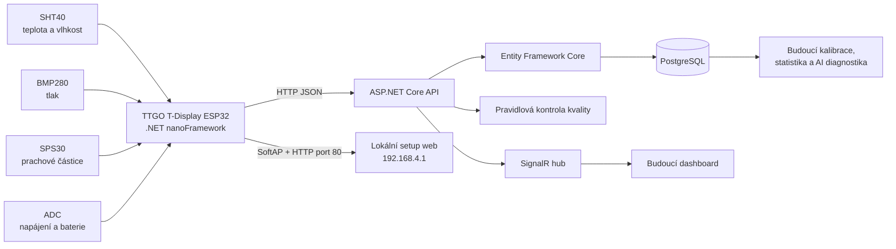
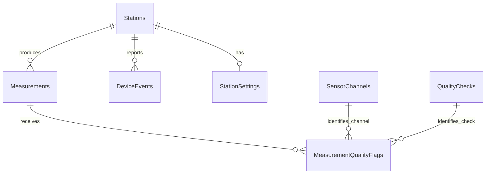
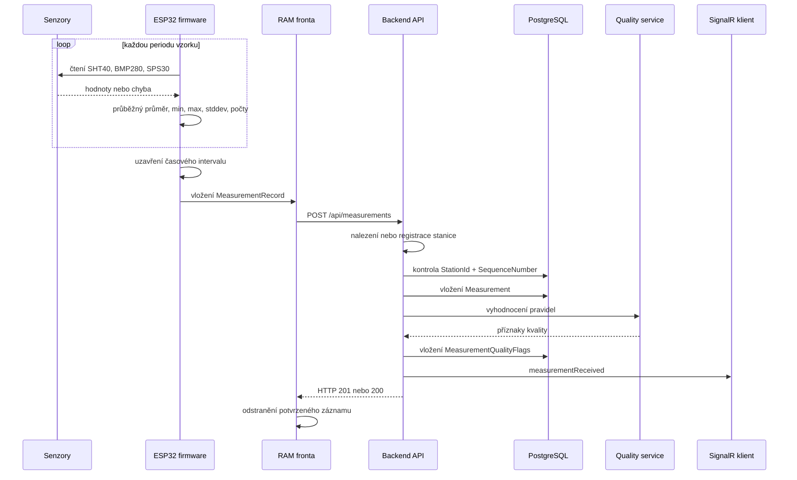

# MeteoStanice - architektura a podrobný popis systému

## 1. Účel dokumentu

Tento dokument popisuje aktuální technický stav systému MeteoStanice. Je určen jako podklad pro technickou část diplomové práce. Popisuje:

- fyzickou meteostanici založenou na ESP32 a .NET nanoFramework,
- připojené senzory a způsob jejich čtení,
- lokální konfiguraci stanice,
- agregaci, ukládání do fronty a odesílání měření,
- backendové REST API v ASP.NET Core,
- databázi PostgreSQL a význam všech tabulek a sloupců,
- registraci a rozlišení více fyzických stanic,
- kontrolu kvality dat,
- nasazení pomocí Dockeru na lokálním serveru nebo NAS,
- současná omezení a plán dalšího rozvoje,
- plán kalibrace, statistické diagnostiky a AI klasifikace poruch senzorů.

Dokument rozlišuje mezi funkcemi, které jsou již implementovány, a funkcemi plánovanými pro další fázi projektu.

## 2. Cíl systému

Cílem systému je provozovat více samostatných nízkonákladových meteostanic, které:

1. periodicky čtou fyzikální veličiny z připojených senzorů,
2. vytvářejí časově zarovnané intervalové záznamy,
3. uchovávají diagnostické informace o kvalitě jednotlivých čtení,
4. odesílají výsledky přes Wi-Fi do centrálního API,
5. automaticky se registrují v backendu,
6. ukládají data do PostgreSQL,
7. umožňují zpětné vyhodnocení kvality, kalibraci a budoucí diagnostiku vad senzorů.

Systém je navržen pro více fyzických stanic. Každá stanice má vlastní trvalý identifikátor `StationGuid`, hardwarový identifikátor a backendem přidělený čitelný kód, například `meteostanice-001`.

## 3. Celková architektura



Systém se skládá z následujících vrstev:

| Vrstva | Projekt nebo zařízení | Úloha |
|---|---|---|
| Senzorická vrstva | SHT40, BMP280, SPS30 | Fyzické měření prostředí |
| Vestavěná vrstva | `MeteoStanice` | Firmware ESP32, měření, agregace, setup, komunikace |
| Přenosová vrstva | Wi-Fi, HTTP, JSON | Přenos měření a událostí |
| Aplikační vrstva | `MeteoStanice.Api` | Registrace stanic, příjem dat, API, migrace |
| Datová vrstva | `MeteoStanice.Data` | Entity Framework Core model a PostgreSQL |
| Kontraktní vrstva | `MeteoStanice.Contracts` | Datové objekty přenášené mezi zařízeními a API |
| Vrstva kvality | `MeteoStanice.Quality` | Pravidlové vyhodnocení kvality měření |
| Prezentační vrstva | `MeteoStanice.Web`, `MeteoStanice.Desktop` | Zatím pouze připravené základní projekty |

## 4. Struktura řešení

### 4.1 Projekt `MeteoStanice`

Firmware pro LILYGO TTGO T-Display ESP32. Cílovou platformou je `.NET nanoFramework,Version=v1.0`. Projekt obsahuje:

- ovladače I2C senzorů,
- hlavní nekonečnou provozní smyčku,
- časově zarovnanou agregaci měření,
- fronty měření a událostí,
- HTTP klienta,
- Wi-Fi klienta,
- SoftAP provisioning portal,
- práci s interní flash pamětí,
- obsluhu tlačítka,
- ST7789 displej,
- NTP synchronizaci,
- sledování napájení a baterie.

### 4.2 Projekt `MeteoStanice.Api`

ASP.NET Core Web API pro .NET 10. Obsahuje:

- endpointy pro měření a události,
- automatickou registraci fyzických stanic,
- autentizaci zařízení pomocí API klíče,
- automatické databázové migrace při startu,
- kontrolu kvality přijatých měření,
- SignalR hub pro budoucí živý dashboard,
- Swagger dokumentaci.

### 4.3 Projekt `MeteoStanice.Data`

Datová vrstva používající Entity Framework Core 10 a provider Npgsql pro PostgreSQL. Obsahuje entity, konfiguraci indexů a databázové migrace.

### 4.4 Projekt `MeteoStanice.Contracts`

Definuje přenosové objekty:

- `MeasurementUploadRequest`,
- `MeasurementDto`,
- `DeviceEventUploadRequest`,
- `DeviceEventDto`,
- `QualityFlagDto`.

### 4.5 Projekt `MeteoStanice.Quality`

Obsahuje první vrstvu automatické kontroly dat založenou na explicitních pravidlech a statistických hodnotách vypočtených ve stanici.

### 4.6 Projekty `MeteoStanice.Web` a `MeteoStanice.Desktop`

Tyto projekty jsou nyní pouze výchozí kostry aplikací. Web obsahuje demonstrační stránky vytvořené šablonou a desktopová aplikace prázdné WPF okno. Nejde zatím o funkční dashboard systému.

## 5. Hardwarová část meteostanice

### 5.1 Řídicí deska

Použitá deska je `LILYGO TTGO T-Display ESP32 1.14` s firmware targetem `ESP32_GenericDisplay_REV0`.

Důležité piny:

| Funkce | GPIO |
|---|---:|
| I2C SDA | 21 |
| I2C SCL | 22 |
| SPI SCK displeje | 18 |
| SPI MOSI displeje | 19 |
| SPI MISO | 12 |
| Display CS | 5 |
| Display DC | 16 |
| Display reset | 23 |
| Podsvícení | 4 |
| ADC baterie | 34 |
| Napájení ADC děliče | 14 |
| Setup tlačítko | 35 |

Displej ST7789 má fyzické rozlišení 135 x 240 bodů a firmware jej používá v orientaci odpovídající rozložení TTGO T-Display.

### 5.2 SHT40

SHT40 měří:

- teplotu ve stupních Celsia,
- relativní vlhkost v procentech.

Komunikace probíhá přes I2C na adrese `0x44`. Firmware používá příkaz `0xFD`, čeká 12 ms a načte šest bajtů. Každá dvojice datových bajtů je chráněna CRC.

Převod surových hodnot:

```text
teplota = -45 + 175 * rawTemperature / 65535
vlhkost = -6 + 125 * rawHumidity / 65535
```

Vlhkost je následně omezena do fyzikálního rozsahu 0 až 100 %.

### 5.3 BMP280

BMP280 měří atmosférický tlak. Pomocná teplota čipu se používá pro kompenzační výpočet tlaku, není však ukládána jako hlavní teplota prostředí.

Firmware hledá senzor na adresách:

- `0x76`,
- `0x77`.

Ověřuje identifikátor čipu `0x58`, provede softwarový reset, načte tovární kalibrační konstanty z registrů od `0x88` a používá forced mode. Výsledný tlak se ukládá v hPa.

Tovární kompenzační konstanty BMP280 nejsou uživatelskou kalibrací stanice. Jde o součást standardního převodu surových dat senzoru.

### 5.4 SPS30

SPS30 měří aerosolové částice přes I2C na adrese `0x69`. Firmware při prvním použití spustí měření příkazem `0x0010` s argumentem `0x0300`.

Zpracovávané hodnoty:

- hmotnostní koncentrace PM1.0,
- hmotnostní koncentrace PM2.5,
- hmotnostní koncentrace PM4.0,
- hmotnostní koncentrace PM10,
- početní koncentrace částic nad 0,5 um,
- početní koncentrace částic nad 1,0 um,
- početní koncentrace částic nad 2,5 um,
- početní koncentrace částic nad 4,0 um,
- početní koncentrace částic nad 10 um,
- typická velikost částic.

Před čtením hodnot se kontroluje příznak připravenosti dat. Data SPS30 jsou chráněna CRC po jednotlivých datových slovech. Pokud data ještě nejsou připravena, stav je veden jako `WAIT`, nikoli jako tvrdá chyba senzoru.

### 5.5 Napájení

Napětí baterie je čteno ADC kanálem 6. Firmware provádí průměr ze čtyř ADC čtení a používá předpokládané referenční napětí 3,3 V a dělič s násobkem 2.

Aktuální prahy:

| Význam | Napětí |
|---|---:|
| Baterie je považována za přítomnou | alespoň 3,0 V |
| Nízká baterie | méně než 3,5 V |
| Rozlišení baterie a externího zdroje | 3,9 V |

Při provozu na baterii se SPS30 záměrně nečte, aby se snížila spotřeba. Tato skutečnost se ukládá do diagnostických počtů a stavu intervalu.

## 6. Identita stanice

Firmware používá několik identifikátorů s odlišným významem:

| Hodnota | Význam |
|---|---|
| `StationGuid` | Trvalý GUID fyzické stanice, vytvořený při prvním spuštění a uložený ve flash |
| `DeviceHardwareId` | Identifikátor fyzické desky ve tvaru prefixu TTGO a GUID |
| `StationId` | Čitelný provozní kód, který může backend změnit například na `meteostanice-001` |
| `Station.Name` | Uživatelsky zobrazovaný název stanice |
| `Station.Id` | Primární databázový GUID záznamu stanice |

Při prvním startu obsahuje konfigurace placeholder `METEO-TEST-001`. Backend placeholder rozpozná a přidělí první volný kód ve formátu:

```text
meteostanice-001
meteostanice-002
meteostanice-003
```

Firmware přečte `stationCode` z úspěšné odpovědi API, zapíše jej do `StationId` a uloží jej do flash. Tím se přidělený název zachová po restartu.

V normálním provozním režimu displej používá číselnou část kódu stanice jako krátký nadpis. Například `meteostanice-001`, `METEO-TEST-001` nebo název končící číslem 1 se zobrazí jako `METEO1`. Po přidělení nového kódu backendem se nadpis aktualizuje za běhu bez restartu. V konfiguračním režimu se místo něj stále zobrazuje `SETUP`.

Backend při identifikaci stanice postupuje přibližně takto:

1. hledá stanici podle `HardwareId`,
2. poté podle `StationGuid`,
3. poté podle neplaceholderového `StationCode`,
4. pokud stanice neexistuje, vytvoří nový záznam,
5. při konfliktu kódu nebo GUID s jiným hardwarem vytvoří novou identitu a kód,
6. vložení při souběžné registraci opakuje až pětkrát.

## 7. Konfigurace uložená ve stanici

Konfigurace se ukládá do interní flash jako textový key-value soubor:

```text
I:\meteo.cfg
```

### 7.1 Konfigurační položky

| Položka | Význam | Výchozí hodnota |
|---|---|---|
| `StationId` | Provozní kód stanice | `METEO-TEST-001` |
| `StationGuid` | Trvalý GUID stanice | automaticky vytvořen |
| `DeviceHardwareId` | Trvalá identita desky | automaticky vytvořena |
| `StationName` | Čitelný název zařízení | testovací název |
| `FirmwareVersion` | Verze firmwaru | `0.1.0-test` |
| `WifiSsid` | SSID provozní Wi-Fi | prázdné |
| `WifiPassword` | Heslo provozní Wi-Fi | prázdné |
| `UseDhcp` | Použití DHCP | `true` |
| `StaticIpAddress` | Statická IP při vypnutém DHCP | `192.168.4.50` |
| `GatewayAddress` | Výchozí brána | `192.168.4.1` |
| `SubnetMask` | Maska sítě | `255.255.255.0` |
| `DnsAddress` | DNS server | `8.8.8.8` |
| `ApiBaseUrl` | Základní URL API | prázdné |
| `ApiKey` | Klíč v HTTP hlavičce | prázdné |
| `MeasurementIntervalMinutes` | Délka výsledného intervalu | 10 minut |
| `SamplePeriodSeconds` | Perioda čtení senzorů | 1 sekunda |
| `MeasurementUploadsPerCycle` | Historická konfigurace limitu uploadu | 2 |
| `EventUploadsPerCycle` | Historická konfigurace limitu uploadu událostí | 4 |
| `LocationText` | Textové místo stanice | prázdné |
| `ProvisioningAccessPointName` | Název setup AP | `MeteoStanice-TTGO-Setup` |
| `ProvisioningPassword` | Heslo setup AP | `12345678` |
| `ProvisioningAddress` | IP setup portálu | `192.168.4.1` |
| `ProvisioningHostName` | Starší kompatibilní alias | `meteo` |
| `ProvisioningWindowMilliseconds` | Starší délka setup okna | 60000 ms |
| `ProvisioningRequestedOnNextBoot` | Starší příznak setupu po restartu | `false` |

Položky `MeasurementUploadsPerCycle` a `EventUploadsPerCycle` jsou v konfiguraci zachovány, ale aktuální samostatný upload worker odesílá vždy nejvýše jeden záznam v jednom průchodu. Tyto položky nyní přímo neřídí pracovní vlákno.

### 7.2 Validace konfigurace

Při běžném startu firmware vyžaduje základní identitu a platnou konfiguraci. Webový setup při uložení vyžaduje pouze:

- neprázdné Wi-Fi SSID,
- neprázdné Wi-Fi heslo.

API URL, API klíč, statické síťové hodnoty, intervaly a místo jsou volitelné nebo mají výchozí hodnoty.

## 8. Setup režim

Setup režim se nespouští automaticky po restartu. Stanice standardně startuje rovnou v režimu měření. Setup se aktivuje fyzickým tlačítkem na GPIO35 za běhu zařízení.

### 8.1 Přechod do setupu

Po stisku tlačítka firmware:

1. pozastaví upload worker,
2. zobrazí setup režim na displeji,
3. odpojí klientské připojení k provozní Wi-Fi,
4. aktivuje SoftAP,
5. nastaví IP `192.168.4.1`,
6. spustí DHCP server,
7. spustí jednoduchý HTTP server na portu 80,
8. čeká na uložení konfigurace nebo další stisk tlačítka.

DNS alias není pro přístup vyžadován. Hlavní přístupová adresa je:

```text
http://192.168.4.1/
```

### 8.2 Setup formulář

Formulář obsahuje:

- výběr nebo ruční zadání Wi-Fi SSID,
- Wi-Fi heslo,
- API URL,
- API klíč,
- přepínač DHCP,
- statickou IP,
- bránu,
- masku,
- DNS,
- interval výsledného měření,
- periodu vzorkování,
- historické limity uploadu,
- textové místo meteostanice.

Po odeslání formuláře se konfigurace uloží do flash a ihned se znovu načte a ověří. Web vrátí stránku `ULOZENO` nebo `CHYBA`. Setup zůstává aktivní, dokud uživatel znovu nestiskne tlačítko.

### 8.3 Návrat do meteo režimu

Při ukončení setupu firmware:

1. ukončí web server a DHCP,
2. vypne SoftAP,
3. načte aktuální konfiguraci z flash,
4. znovu vytvoří identitu a měřicí cyklus,
5. připojí se k nastavené Wi-Fi,
6. synchronizuje čas,
7. nastaví API klienta,
8. obnoví upload worker.

## 9. Připojení k Wi-Fi a API

### 9.1 Wi-Fi

Firmware podporuje:

- DHCP,
- statickou IPv4 adresu,
- masku sítě,
- výchozí bránu,
- DNS server.

Při připojování zobrazuje diagnostické stavy jako `POKUS`, `HESLO CHYBA`, `SIT NENALEZ`, `AUTH CHYBA`, `DHCP TIMEOUT` nebo `PRIPOJENO`.

### 9.2 API URL

URL se normalizuje následovně:

- pokud chybí schéma, doplní se `http://`,
- pokud chybí port, doplní se port `5181`,
- pokud chybí cesta, doplní se `/api`,
- odstraní se koncové lomítko.

Aktuální firmware podporuje pro upload pouze prosté HTTP. HTTPS není v nízkoúrovňovém socket klientovi implementováno.

Příklad adresy API na NAS:

```text
http://192.168.0.102:32778/api
```

## 10. Čas a synchronizace stanic

Firmware synchronizuje systémový čas pomocí NTP serveru `pool.ntp.org`.

| Parametr | Hodnota |
|---|---:|
| NTP port | UDP 123 |
| Timeout | 4 s |
| Standardní synchronizace | každých 6 hodin |
| Opakování po chybě | za 15 minut |
| Doba důvěry v synchronizaci | 24 hodin |

Do databáze se ukládají UTC časy. Pro zobrazení se mají převádět do časové zóny `Europe/Prague`.

Displej firmwaru nyní používá pevný posun UTC+2. Toto řešení samo nezohledňuje zimní čas a patří mezi známá omezení. Backend a PostgreSQL pracují korektně s UTC a mohou používat časovou zónu `Europe/Prague` v dotazech.

## 11. Měřicí cyklus

### 11.1 Vzorkování

Hlavní smyčka provede jedno čtení všech senzorů podle `SamplePeriodSeconds`. Ve výchozím nastavení jde o jeden vzorek za sekundu.

Při desetiminutovém intervalu je očekávaný počet vzorků:

```text
10 minut * 60 sekund / 1 sekunda = 600 vzorků
```

### 11.2 Zarovnání intervalů

Intervaly jsou zarovnány podle UTC času. Při desetiminutové konfiguraci se uzavírají například v:

```text
14:00, 14:10, 14:20, 14:30, ...
```

Pokud mají všechny stanice synchronizovaný čas, vytvoří záznam pro stejnou časovou hranici. Odeslání může proběhnout s mírným různým zpožděním, ale `MeasuredAt` zůstává stejný.

### 11.3 Agregace

Firmware během otevřeného intervalu udržuje průběžné součty, počty a statistiky. Po uzavření vytvoří jeden `NanoMeasurementRecord`.

Pro hlavní veličiny se ukládá:

- aritmetický průměr,
- minimum,
- maximum,
- směrodatná odchylka,
- počet úspěšných čtení,
- počet chyb nebo čekání.

Průběžný výpočet směrodatné odchylky zabraňuje nutnosti uchovávat všech 600 surových vzorků v omezené paměti ESP32.

### 11.4 Stav měřicího intervalu

`MeasurementStatus` má následující číselné hodnoty:

| Hodnota | Stav | Význam |
|---:|---|---|
| 0 | `Ok` | Dostatek platných dat |
| 1 | `InsufficientSamples` | Nedostatek platných vzorků |
| 2 | `Sht40ReadFailed` | Chyba SHT40 |
| 3 | `Bmp280ReadFailed` | Chyba BMP280 |
| 4 | `Sps30ReadFailed` | Chyba SPS30 |
| 5 | `BackupPowerActive` | Interval proběhl na baterii |
| 6 | `Sps30DisabledOnBattery` | SPS30 byl na baterii vypnut |

nanoFramework může při volání `Enum.ToString()` odeslat číselnou podobu, a proto může databáze obsahovat například řetězce `"1"` nebo `"5"`.

Aktuálně se jako hlavní stav uchovává první nenulový stav intervalu. Detailnější diagnostika zůstává dostupná v samostatných počtech úspěchů, chyb a čekání.

## 12. Lokální fronty a upload worker

Firmware používá dvě RAM fronty:

| Fronta | Kapacita | Obsah |
|---|---:|---|
| Měření | 64 | Uzavřené intervalové záznamy |
| Události | 16 | Diagnostické a provozní události |

Samostatné vlákno `NanoUploadWorker` odděluje síťové operace od hlavní měřicí smyčky. Díky tomu pomalá odpověď API nemá přímo zastavit čtení senzorů.

Chování workeru:

- při prázdných frontách čeká 1 sekundu,
- přednostně odesílá měření,
- pokud není měření odesláno, pokusí se o událost,
- po úspěchu čeká 5 sekund,
- po neúspěchu čeká 60 sekund,
- samotný HTTP klient má navíc 30sekundový backoff,
- záznam se z fronty odstraní až po HTTP odpovědi 2xx.

HTTP stav `201` znamená vytvoření nového záznamu. Stav `200` znamená, že API nalezlo již existující záznam a vrátilo jej jako idempotentní opakování.

Fronty jsou pouze v RAM. Restart zařízení jejich obsah smaže. Tato vlastnost je důležitým současným omezením.

## 13. Přenosový formát měření

Firmware posílá JSON metodou `POST` na:

```text
/api/measurements
```

Součástí requestu jsou:

- identita stanice,
- verze firmwaru,
- stabilní číselný identifikátor intervalu ve formátu UTC `yyyyMMddHHmmss`,
- čas intervalu,
- průměrné senzorové hodnoty,
- počty úspěšných a chybných čtení,
- minima, maxima a směrodatné odchylky,
- stav intervalu.

API klíč se posílá v hlavičce:

```http
X-Api-Key: <hodnota>
```

## 14. Backend API

### 14.1 Technologie

- ASP.NET Core pro .NET 10,
- Entity Framework Core 10,
- Npgsql PostgreSQL provider,
- Swagger/OpenAPI,
- SignalR,
- Docker.

### 14.2 Start aplikace

Při startu API:

1. načte connection string `MeteoDatabase`,
2. nastaví PostgreSQL provider a assembly s migracemi,
3. zjistí aplikované a čekající migrace,
4. zavolá `Database.Migrate()`,
5. spustí controllery, Swagger a SignalR.

Databáze jako taková musí v PostgreSQL existovat. API automaticky vytváří a aktualizuje její tabulky, indexy a vazby.

### 14.3 Endpointy

| Metoda | Cesta | Účel | API klíč |
|---|---|---|---|
| GET | `/api` | Kontrola běhu API | ne |
| POST | `/api/measurements` | Uložení měření | ano, pokud je nakonfigurován |
| GET | `/api/measurements/{stationGuid}/recent?take=100` | Poslední měření stanice | ne |
| POST | `/api/events` | Uložení události | ano, pokud je nakonfigurován |
| GET | `/api/events/{stationGuid}/recent?take=100` | Poslední události stanice | ne |
| SignalR | `/hubs/meteo` | Živé oznámení o novém měření | podle současné CORS konfigurace |
| Swagger | `/swagger` | Dokumentace a testování API | ne |

Parametr `take` je omezen na rozsah 1 až 1000.

### 14.4 API klíč

Pokud `StationApi:ApiKey` není nastaven, upload endpointy přijímají request bez klíče. Pokud nastaven je, musí se přesně shodovat hlavička `X-Api-Key`. Při neshodě API vrátí HTTP 401.

### 14.5 Registrace stanice

Registrace není samostatný endpoint. Proběhne automaticky při prvním uploadu měření nebo události. API vytvoří `Station`, přiřadí jí GUID a čitelný kód a odpověď vrátí firmwaru.

### 14.6 Deduplikace

Současná implementace považuje záznam za duplicitní podle kombinace:

```text
StationId + SequenceNumber
```

Stejná kombinace má v databázi unikátní index. Tento mechanismus brání dvojímu uložení při opakování stejného HTTP requestu.

`SequenceNumber` měření již není čítač v RAM. Firmware jej odvozuje z UTC konce intervalu ve formátu `yyyyMMddHHmmss`. Interval ukončený například `2026-10-24 11:30:00 UTC` má hodnotu `20261024113000`. Po restartu proto stejný interval dostane stejné číslo a nový časový interval jiné číslo. Různé stanice mohou mít stejné číslo, protože unikátnost se vyhodnocuje společně s `StationId`.

### 14.7 SignalR

Po vytvoření nového měření API vyšle všem klientům metodu:

```text
measurementReceived
```

Tato část je připravena pro budoucí živý dashboard. Duplicitní měření, které vrací HTTP 200, novou SignalR zprávu nevytváří.

## 15. Databázový model

### 15.1 Přehled vazeb



PostgreSQL používá pro časy typ `timestamp with time zone`. Aplikace zapisuje UTC a lokální čas se vytváří až při zobrazení.

### 15.2 Tabulka `Stations`

Eviduje jednu fyzickou meteostanici.

| Sloupec | Typ | Povinný | Význam |
|---|---|---:|---|
| `Id` | `uuid` | ano | Primární databázový klíč stanice |
| `StationGuid` | `uuid` | ano | Trvalý GUID vytvořený firmwarem |
| `StationCode` | `varchar(64)` | ano | Čitelný unikátní kód, např. `meteostanice-001` |
| `Name` | `varchar(160)` | ano | Zobrazovaný název |
| `LocationText` | `varchar(200)` | ano | Textové umístění stanice |
| `HardwareId` | `varchar(120)` | ano | Identita fyzické desky |
| `FirmwareVersion` | `varchar(40)` | ano | Naposledy oznámená verze firmwaru |
| `CreatedAt` | `timestamptz` | ano | Čas registrace v backendu |
| `LastSeenAt` | `timestamptz` | ne | Čas posledního nově uloženého měření nebo události |
| `IsActive` | `boolean` | ano | Administrativní aktivita stanice |

Indexy:

- unikátní `StationGuid`,
- unikátní `StationCode`.

`LastSeenAt` neudává čas měření. Udává čas posledního nového záznamu, který API od stanice úspěšně uložilo. Nejde o samostatný heartbeat a duplicitní požadavek tuto hodnotu neaktualizuje. Pro odvození stavu online/offline ji proto lze použít pouze orientačně.

### 15.3 Tabulka `Measurements`

Obsahuje jeden agregovaný záznam za uzavřený interval jedné stanice.

#### Identita a čas

| Sloupec | Typ | Význam |
|---|---|---|
| `Id` | `uuid` | Primární klíč měření vytvořený backendem |
| `StationId` | `uuid` | Cizí klíč do `Stations.Id` |
| `SequenceNumber` | `bigint` | UTC konec intervalu zakódovaný jako `yyyyMMddHHmmss` |
| `MeasuredAt` | `timestamptz` | Čas uzavření měřicího intervalu |
| `CreatedAt` | `timestamptz` | Čas přijetí a uložení API |

Rozdíl `CreatedAt - MeasuredAt` vyjadřuje zpoždění uploadu.

#### Průměrné veličiny

| Sloupec | Typ | Jednotka | Význam |
|---|---|---|---|
| `TemperatureCelsius` | `double precision`, nullable | °C | Průměrná teplota SHT40 |
| `HumidityPercent` | `double precision`, nullable | % RH | Průměrná relativní vlhkost |
| `PressureHpa` | `double precision`, nullable | hPa | Průměrný absolutní tlak BMP280 |
| `Pm1` | `double precision`, nullable | µg/m³ | Průměrná PM1.0 |
| `Pm25` | `double precision`, nullable | µg/m³ | Průměrná PM2.5 |
| `Pm4` | `double precision`, nullable | µg/m³ | Průměrná PM4.0 |
| `Pm10` | `double precision`, nullable | µg/m³ | Průměrná PM10 |
| `NumberPm05` | `double precision`, nullable | početní koncentrace | Částice nad 0,5 um |
| `NumberPm1` | `double precision`, nullable | početní koncentrace | Částice nad 1,0 um |
| `NumberPm25` | `double precision`, nullable | početní koncentrace | Částice nad 2,5 um |
| `NumberPm4` | `double precision`, nullable | početní koncentrace | Částice nad 4,0 um |
| `NumberPm10` | `double precision`, nullable | početní koncentrace | Částice nad 10 um |
| `TypicalParticleSize` | `double precision`, nullable | µm | Typická velikost částic |

#### Napájení

| Sloupec | Typ | Význam |
|---|---|---|
| `BatteryVoltage` | `double precision`, nullable | Napětí baterie |
| `PowerSource` | `varchar(16)` | Zdroj, například `BAT` nebo `SRC` |

Tyto sloupce v databázovém modelu existují, ale aktuální `NanoMeasurementRecord` je zatím neposílá v JSON payloadu. Napájení se nyní zobrazuje na displeji a ovlivňuje chování SPS30, ale databázové hodnoty nejsou firmwarem plně naplněny.

#### Úplnost vzorkování

| Sloupec | Typ | Význam |
|---|---|---|
| `ExpectedSampleCount` | `integer` | Očekávaný počet vzorků v intervalu |
| `ReceivedSampleCount` | `integer` | Počet skutečně zpracovaných kroků |
| `Sht40OkCount` | `integer` | Úspěšná čtení SHT40 |
| `Sht40ErrorCount` | `integer` | Chybná čtení SHT40 |
| `Bmp280OkCount` | `integer` | Úspěšná čtení BMP280 |
| `Bmp280ErrorCount` | `integer` | Chybná čtení BMP280 |
| `Sps30OkCount` | `integer` | Úspěšná čtení SPS30 |
| `Sps30WaitCount` | `integer` | SPS30 ještě neměl připravená data |
| `Sps30ErrorCount` | `integer` | Chybná čtení SPS30 |
| `Sps30BatterySkippedCount` | `integer` | Čtení vynechaná kvůli baterii |

#### Intervalové statistiky

| Skupina | Sloupce |
|---|---|
| Teplota | `TemperatureMin`, `TemperatureMax`, `TemperatureStdDev` |
| Vlhkost | `HumidityMin`, `HumidityMax`, `HumidityStdDev` |
| Tlak | `PressureMin`, `PressureMax`, `PressureStdDev` |
| PM2.5 | `Pm25Min`, `Pm25Max`, `Pm25StdDev` |
| PM10 | `Pm10Min`, `Pm10Max`, `Pm10StdDev` |

Všechny jsou typu `double precision` a mohou být `NULL` na úrovni databáze.

#### Stav

| Sloupec | Typ | Význam |
|---|---|---|
| `Status` | `varchar(64)` | Stav uzavřeného intervalu z firmwaru |

Indexy:

- unikátní `(StationId, SequenceNumber)`,
- neunikátní `(StationId, MeasuredAt)` pro rychlé časové dotazy.

### 15.4 Tabulka `DeviceEvents`

Obsahuje provozní a diagnostické události zařízení.

| Sloupec | Typ | Význam |
|---|---|---|
| `Id` | `uuid` | Primární klíč události |
| `StationId` | `uuid` | Stanice, která událost vytvořila |
| `SequenceNumber` | `integer` | Lokální pořadí události |
| `OccurredAt` | `timestamptz` | Čas vzniku na stanici |
| `Severity` | `varchar(32)` | Závažnost |
| `Category` | `varchar(64)` | Oblast systému |
| `Code` | `varchar(80)` | Strojově čitelný kód |
| `Component` | `varchar(120)` | Komponenta původu |
| `Message` | `varchar(500)` | Lidsky čitelný popis |
| `CreatedAt` | `timestamptz` | Čas uložení backendem |
| `ResolvedAt` | `timestamptz`, nullable | Čas vyřešení; zatím se aktivně nepoužívá |

Unikátní index je `(StationId, SequenceNumber)`.

Závažnosti:

- `Information`,
- `Warning`,
- `Error`,
- `Critical`.

Kategorie:

- `Sensor`,
- `Communication`,
- `Network`,
- `Time`,
- `Power`,
- `Storage`,
- `Configuration`,
- `System`.

Události pokrývají například start zařízení, výpadek napájení, nízkou baterii, chyby senzorů, Wi-Fi, serveru, času, fronty a konfigurace.

### 15.5 Tabulka `StationSettings`

Je připravena pro centrálně řízená nastavení stanice.

| Sloupec | Typ | Význam |
|---|---|---|
| `Id` | `uuid` | Primární klíč nastavení |
| `StationId` | `uuid` | Jedna konkrétní stanice |
| `MeasurementIntervalMinutes` | `integer` | Požadovaný interval měření |
| `SamplePeriodSeconds` | `integer` | Požadovaná perioda vzorku |
| `LocationText` | `varchar(200)` | Umístění stanice |
| `Version` | `integer` | Monotónní verze konfigurace |
| `UpdatedAt` | `timestamptz` | Poslední změna |

Na `StationId` je unikátní index, takže stanice může mít právě jeden aktuální konfigurační záznam. Firmware nyní nastavení z backendu nestahuje; tabulka je připravena pro budoucí synchronizaci.

### 15.6 Tabulka `SensorChannels`

Číselník měřených nebo diagnostických kanálů.

| Sloupec | Typ | Význam |
|---|---|---|
| `Id` | `integer identity` | Primární klíč |
| `Code` | `varchar(64)` | Stabilní kód, např. `temperature`, `pm25` |
| `Name` | `varchar(120)` | Čitelný název |
| `Unit` | `varchar(24)` | Jednotka |

`Code` je unikátní. Při prvním výskytu příznaku kvality API kanál automaticky vytvoří. Aktuálně se `Name` inicializuje stejnou hodnotou jako `Code` a `Unit` zůstává prázdná.

### 15.7 Tabulka `QualityChecks`

Číselník typů kontrol kvality.

| Sloupec | Typ | Význam |
|---|---|---|
| `Id` | `integer identity` | Primární klíč |
| `Code` | `varchar(64)` | Stabilní kód kontroly |
| `Name` | `varchar(120)` | Čitelný název |
| `Description` | `varchar(500)` | Detailní popis |
| `DefaultSeverity` | `varchar(32)` | Výchozí závažnost |
| `Enabled` | `boolean` | Aktivita definice |

`Code` je unikátní. API definici vytváří automaticky při prvním výskytu, ale aktuální vyhodnocovací služba zatím před výpočtem nečte příznak `Enabled`.

### 15.8 Tabulka `MeasurementQualityFlags`

Obsahuje konkrétní zjištěný problém jednoho měření.

| Sloupec | Typ | Význam |
|---|---|---|
| `Id` | `uuid` | Primární klíč příznaku |
| `MeasurementId` | `uuid` | Měření, ke kterému příznak patří |
| `SensorChannelId` | `integer` | Dotčený kanál |
| `QualityCheckId` | `integer` | Typ kontroly |
| `Severity` | `varchar(32)` | Konkrétní závažnost |
| `Message` | `varchar(500)` | Vysvětlení |
| `CreatedAt` | `timestamptz` | Čas vytvoření příznaku |

### 15.9 Tabulka `__EFMigrationsHistory`

Technická tabulka Entity Framework Core. Uchovává seznam aplikovaných migrací a neslouží k měřeným datům.

## 16. Kontrola kvality dat

Kontrola probíhá po uložení nového měření. API načte poslední předchozí měření stejné stanice a zavolá `MeasurementQualityService`.

### 16.1 Kontrola rozsahu

| Kanál | Povolený rozsah |
|---|---:|
| Teplota | -40 až 70 °C |
| Vlhkost | 0 až 100 % |
| Tlak | 850 až 1100 hPa |
| PM1 | 0 až 500 |
| PM2.5 | 0 až 500 |
| PM4 | 0 až 600 |
| PM10 | 0 až 700 |
| Početní koncentrace | 0 až 100000 |
| Typická velikost částic | 0 až 20 |

Chybějící nullable hodnota vytváří příznak `MissingValue`. Hodnota mimo rozsah vytváří `OutOfRange`.

### 16.2 Úplnost

Pokud počet úspěšných čtení konkrétního senzoru nedosáhne 80 % očekávaného počtu vzorků, vznikne `LowCompleteness`.

SPS30 se na úplnost nekontroluje, pokud `PowerSource` obsahuje `BAT`.

### 16.3 Flatline

Pokud má kanál alespoň pět vzorků a směrodatná odchylka je nejvýše `0.001`, vznikne příznak `Flatline`.

### 16.4 Skok proti minulému intervalu

| Kanál | Prahová absolutní změna |
|---|---:|
| Teplota | 8 °C |
| Vlhkost | 30 procentních bodů |
| PM1 | 150 |
| PM2.5 | 150 |
| PM4 | 180 |
| PM10 | 200 |

Překročení vytváří `SuddenJump`.

### 16.5 Opakovaná konstanta

Pokud mají aktuální i předchozí interval stejný průměr v toleranci `0.001` a zároveň oba téměř nulovou směrodatnou odchylku, vznikne `RepeatedConstant`.

### 16.6 Fyzikální pořadí PM

Kontrola očekává:

```text
PM1 <= PM2.5 <= PM4 <= PM10
```

Při porušení vznikne `ParticleMassOrder`.

### 16.7 Kontext baterie

Měření označené zdrojem `BAT` dostane informační příznak `BatteryContext`.

## 17. Provozní tok jednoho měření



## 18. Časy v systému

| Hodnota | Zdroj | Význam |
|---|---|---|
| `MeasuredAt` | stanice | Konec měřicího intervalu |
| `CreatedAt` u měření | API | Čas přijetí záznamu |
| `OccurredAt` | stanice | Čas vzniku události |
| `CreatedAt` u události | API | Čas přijetí události |
| `LastSeenAt` | API | Čas posledního nově uloženého měření nebo události |
| `UpdatedAt` | API | Čas změny vzdáleného nastavení |

`LastSeenAt` lze použít pro orientační stav dostupnosti, protože v systému zatím není samostatný heartbeat:

- do přibližně 20 minut: online,
- 20 až 60 minut: zpoždění nebo varování,
- déle než 60 minut: offline.

Prahy nejsou nyní implementovány jako endpoint nebo služba; jde o doporučenou interpretační logiku pro dashboard.

## 19. Nasazení

### 19.1 Lokální Docker Compose

Soubor `docker-compose.yml` definuje:

- PostgreSQL 17,
- ASP.NET API,
- trvalý Docker volume databáze,
- healthcheck PostgreSQL,
- závislost startu API na zdravé databázi.

Výchozí lokální mapování:

| Služba | Kontejnerový port | Host port |
|---|---:|---:|
| PostgreSQL | 5432 | 5432 |
| API | 8080 | 5080 |

Výchozí hesla v compose souboru jsou pouze vývojová a pro produkční NAS musí být nahrazena bezpečnými hodnotami.

### 19.2 Synology NAS

Na NAS běží API a PostgreSQL jako samostatné kontejnery nebo jako služby jednoho projektu. API potřebuje proměnnou:

```text
ConnectionStrings__MeteoDatabase=Host=<DB_HOST>;Port=<DB_PORT>;Database=meteostanice;Username=<USER>;Password=<PASSWORD>
```

API poslouchá uvnitř kontejneru na portu 8080. ESP32 používá host port namapovaný v Synology Container Manageru, nikoliv interní port databáze.

Stanice se nikdy nepřipojuje přímo k PostgreSQL. Komunikuje pouze s API.

### 19.3 Migrace

API při startu automaticky volá `Database.Migrate()`. Aktuální migrace:

1. `InitialCreate` - základní tabulky,
2. `AddMeasurementRuntimeFields` - diagnostické počty a intervalové statistiky,
3. `UseGuidPrimaryKeys` - převod hlavních klíčů z `bigint` na `uuid`.

Migrace GUID používá rozšíření PostgreSQL `pgcrypto` a `gen_random_uuid()`.

## 20. Bezpečnost

Aktuálně implementováno:

- volitelný API klíč pro upload,
- oddělení databáze od zařízení,
- přístup stanice pouze přes API,
- lokální setup AP s heslem,
- omezené délky textových databázových polí.

Současná omezení:

- firmware podporuje jen HTTP, nikoli HTTPS,
- výchozí setup heslo je společné,
- CORS dashboard policy povoluje libovolný origin při credentials,
- GET endpointy a Swagger nejsou chráněny,
- databázový `HardwareId` nemá unikátní index, přestože registrační logika očekává jedinečnost,
- API klíč je uložen ve flash v čitelné key-value konfiguraci.

Pro uzavřenou domácí LAN je tento stav použitelný pro vývoj. Pro vzdálený nebo veřejný provoz je nutný reverse proxy s HTTPS, omezení CORS, správa tajných hodnot a autentizace administrativních endpointů.

## 21. Současná známá omezení

### 21.1 Sekvence událostí po restartu

Sekvence měření je stabilní, protože se odvozuje z UTC času intervalu. Samostatný čítač událostí však stále není uložen ve flash a po restartu se vrací na začátek. Databáze má pro události unikátní `(StationId, SequenceNumber)`, takže API může novou událost po restartu vyhodnotit jako starou duplicitu.

Doporučená oprava:

- identitu události odvodit z jejího UTC času a typu, nebo
- vytvořit stabilní GUID události ve stanici,
- případně ukládat čítač událostí perzistentně.

### 21.2 Fronty pouze v RAM

Výpadek API je překlenut pouze do naplnění fronty nebo restartu. Po restartu neodeslané záznamy zaniknou.

Doporučená oprava je perzistentní kruhová fronta ve flash s omezením počtu zápisů a ochranou proti poškození.

### 21.3 Nulové hodnoty při nulovém počtu vzorků

Firmware používá při nulovém počtu hodnot průměr `0`. API proto místo `NULL` může přijmout nulu. U teploty, vlhkosti a PM může nula projít fyzikálním rozsahem, i když ve skutečnosti senzor nic nezměřil.

Kontrola musí vždy kombinovat hodnotu s `OkCount`. Budoucí verze by měla neposílat hodnotu nebo ji označit jako `null`, pokud je počet platných čtení nulový.

### 21.4 Napájení v payloadu

Databáze i kontrakt obsahují `BatteryVoltage` a `PowerSource`, ale nanoFramework payload je aktuálně neposílá. Část backendové kontroly bateriového kontextu se proto nemůže plně uplatnit.

### 21.5 Pevný lokální posun času

Displej používá UTC+2 a automaticky nepřechází mezi letním a zimním časem.

### 21.6 Historické konfigurační limity uploadu

Nastavení počtu uploadů na cyklus zůstává ve formuláři a flash, ale nový upload worker používá vlastní pevné dávkování po jednom záznamu.

### 21.7 Uživatelské rozhraní

SignalR je připraven, ale webový a desktopový dashboard zatím nejsou implementovány.

## 22. Plán kalibrace

Kalibrace bude provedena pouze na backendu. Firmware bude nadále posílat surové agregované hodnoty.

Navržený tok:

```text
Raw měření
-> kontrola kvality
-> výběr platného kalibračního profilu
-> výpočet korigované hodnoty
-> uložení raw i corrected hodnoty
```

Pro lineární kalibraci:

```text
sensor = b0 + b1 * reference
corrected = (sensor - b0) / b1
```

Navržená budoucí tabulka `StationSensorCalibrations`:

| Sloupec | Význam |
|---|---|
| `Id` | GUID kalibračního profilu |
| `StationId` | Kalibrovaná stanice |
| `ChannelCode` | Např. `pm25`, `temperature` |
| `InterceptB0` | Posun regresní přímky |
| `SlopeB1` | Směrnice regresní přímky |
| `ValidFrom` | Začátek platnosti |
| `ValidTo` | Konec platnosti |
| `Source` | Referenční zařízení nebo metoda |
| `R2` | Koeficient determinace |
| `Rmse` | Střední kvadratická chyba |
| `Mae` | Průměrná absolutní chyba |
| `Mbe` | Systematické vychýlení |
| `IsActive` | Aktivní profil |
| `CreatedAt` | Čas vytvoření |

Původní data musí zůstat neměnná. Korigované hodnoty mají být uloženy odděleně nebo vypočteny s přesnou vazbou na verzi kalibrace.

Tři vlastní stanice lze nejdříve kolokovat a provést interkalibraci. Bez profesionálního referenčního přístroje jde o vzájemné srovnání, nikoliv absolutní kalibraci. Robustní pracovní referencí může být medián tří současně měřících stanic.

## 23. Plán dlouhodobého statistického hodnocení

Hodnocení je vhodné rozdělit podle časového horizontu.

### 23.1 Při každém uploadu

Již implementováno:

- fyzikální rozsah,
- úplnost,
- flatline uvnitř intervalu,
- skok proti předchozímu intervalu,
- fyzikální pořadí PM.

### 23.2 Po uzavření společného intervalu

Plán:

- počkat krátkou dobu na doručení všech stanic,
- porovnat stanice se stejným `MeasuredAt`,
- vypočítat medián a MAD,
- označit `CrossStationOutlier`,
- neprovádět automatickou korekci výrazně podezřelého senzoru.

### 23.3 Denní úloha

Plánovaná služba typu `BackgroundService` bude analyzovat klouzavá okna 7 až 30 dnů:

- dlouhodobý drift,
- opakované zamrznutí,
- rostoucí četnost výpadků,
- odchylku od ostatních stanic,
- korelaci,
- EWMA nebo CUSUM,
- RMSE, MAE, MBE a R² vůči referenci,
- vývoj úplnosti dat.

Výsledek nemá měnit raw hodnoty. Vytvoří diagnostický záznam a stav senzoru.

## 24. Plán AI diagnostiky

AI nebude opravovat hodnoty. Jejím úkolem bude klasifikovat pravděpodobný problém senzoru.

Navržené třídy:

- `Normal`,
- `Drift`,
- `Flatline`,
- `Unstable`,
- `IntermittentFailure`,
- `CommunicationFailure`,
- `Outlier`,
- `Degradation`,
- `UnknownAnomaly`.

Vstupní příznaky časového okna:

- průměr a medián,
- směrodatná odchylka,
- minimum a maximum,
- trend a rychlost změny,
- počet chybějících hodnot,
- délka konstantního úseku,
- podíl úspěšných čtení,
- odchylka od mediánu ostatních stanic,
- korelace s ostatními stanicemi,
- odchylka od referenčního zařízení,
- teplota, vlhkost a časový kontext.

Model má vracet například:

```text
ProblemType = Drift
Confidence = 0.91
AnomalyScore = 0.86
```

Navržená evidence diagnózy:

| Hodnota | Význam |
|---|---|
| `StationId` | Stanice |
| `SensorCode` | Fyzický senzor nebo kanál |
| `DiagnosedAt` | Čas vyhodnocení |
| `WindowFrom`, `WindowTo` | Hodnocené období |
| `ProblemType` | Klasifikovaný problém |
| `Confidence` | Jistota klasifikace |
| `AnomalyScore` | Obecná míra anomálie |
| `ModelVersion` | Verze modelu |
| `Evidence` | Hlavní statistické důvody |

Pro první verzi je vhodný hybridní přístup:

1. explicitní pravidla pro jasné chyby,
2. robustní statistika pro drift a odchylky,
3. model typu Random Forest nebo XGBoost pro klasifikaci,
4. Isolation Forest pro doplňkovou detekci dosud neznámých anomálií.

Trénink bude používat více datasetů:

- veřejná data nízkonákladových stanic,
- data SPS30 s referencí,
- datasety driftu a poruch senzorů,
- vlastní data tří stanic,
- synteticky vytvořené vady nad reálnými daty.

Syntetické vady mohou zahrnovat bias, gain error, lineární drift, flatline, šum, špičky, dropout, přerušovanou poruchu a zpomalenou odezvu. Trénovací a testovací množiny musí být děleny podle fyzických senzorů a časových období, nikoliv náhodně po jednotlivých řádcích.

## 25. Doporučené pořadí další implementace

1. Doplnit `BatteryVoltage` a `PowerSource` do firmware payloadu.
2. Posílat chybějící hodnoty jako `NULL`, nikoliv nulu.
3. Stabilizovat idempotenci událostí po restartu.
4. Zavést perzistentní frontu neodeslaných dat.
5. Doplnit endpoint se seznamem stanic a jejich online stavem.
6. Implementovat funkční webový dashboard.
7. Přidat kalibrační tabulky a oddělit raw a corrected hodnoty.
8. Implementovat porovnání tří stanic ve stejném intervalu.
9. Implementovat denní statistickou diagnostiku.
10. Sestavit a vyhodnotit AI model diagnostiky poruch.
11. Zabezpečit produkční komunikaci pomocí HTTPS a administrativní autentizace.

## 26. Shrnutí současného stavu

Aktuálně je funkční hlavní vertikální řetězec:

```text
reálné senzory
-> ESP32
-> časově zarovnaná agregace
-> RAM fronta
-> HTTP API
-> automatická registrace stanice
-> PostgreSQL
-> pravidlová kontrola kvality
-> SignalR oznámení
```

Systém umí obsluhovat více fyzických stanic a uchovává nejen výsledné průměry, ale také data potřebná pro posouzení důvěryhodnosti měření. To vytváří vhodný základ pro kalibraci, porovnání stanic, detekci driftu a budoucí AI diagnostiku.

Za hotové nelze zatím považovat uživatelský dashboard, kalibrační vrstvu, dlouhodobou statistickou úlohu, AI klasifikaci poruch, trvalou offline frontu ani plné produkční zabezpečení. Tyto části tvoří jasně definovaný plán dalšího rozvoje a experimentální část diplomové práce.
